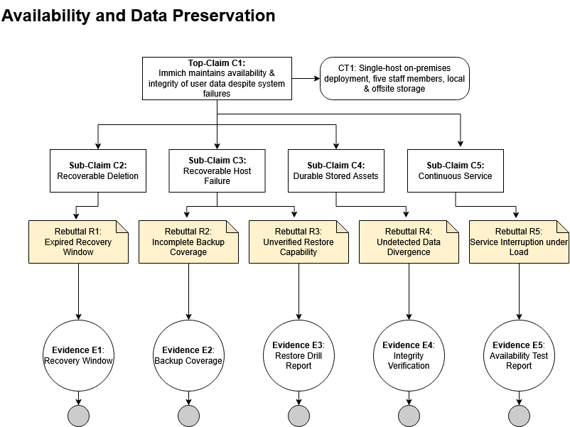

# Immich Software Assurance Case

**Course:** Software Assurance  
**Project:** Immich Open-Source Photo Management System  
**Team:** Team 6

## 1. Introduction and Operational Context

TODO: Briefly describe Immich, the hypothetical operational
environment, and the purpose of the assurance case.

## 2. Top-Level Assurance Claims

The following five claims address critical security properties
of Immich in our assumed operational environment.

### Claim 1: Authentication and Account Access
**Owner:** Christian Theisen

Immich prevents unauthorized access to protected user accounts.

### Claim 2: Photo/Video Access and Authorization

**Owner:** Adu
Immich prevents unauthorized access to protected photos and videos.

PART 1:

1. Introduction

This report creates a security assurance case for the Photo/Video Access & Authorization functionality of the Immich product. This is to develop an argument that demonstrates the product’s capability to safeguard sensitive photographs and videos from unauthorized access within the defined operational environment. The assurance case relies on the findings  prior use-case and misuse-case analysis, particularly section 2.2, Upload and Private Asset Access, and section 2.3, Shared Albums and Public Links. The prior analysis identified major threats related to the violation of authorization including accessing another user’s photograph, exploitation of an active session on a compromised device, circumvention of the Locked Folder protection, and unauthorized access via shared links. In addition, a finding was made concerning the lack of uniformity in enforcing locked asset visibility.
The assurance case to be presented is a trustworthiness plan as opposed to a certification that all control points have been verified. The report will detail the security claims, supporting arguments, possible rebuttals, and evidence that can be used by an organization to make an informed choice regarding the product adoption.

2. Assumed Operational Environment : The operational environment involves a professional photography studio with five employees who use an instance of the self-hosted Immich to store, manage, access, share, and retrieve client photographs and videos. The environment includes studio employees, an administrator, client recipients, the Immich web and mobile applications, a reverse proxy, PostgreSQL, and file storage. The studio’s use of the service is to ensure that the client’s media assets are not disclosed to unauthorized parties, thus upholding the company’s reputation and avoiding the loss of clients’ trust.
  
3. Assurance Case Notation 
The diagram use the following conventions

The diagram below use eclipse for claims, rectangles for evidence, justification and rebuttals. Every terminal evidence node is phrased as a noun phrase and represents an artifact that can be inspected or measured. 

4. Final Top-Level Security Claims

All the four claims are related to the most critical security flaws that were discussed in the previous assignments but are stated in a way that avoids overlaps.

The following four claims address different high-risk security properties and entities

C1 Immich ensures that only authorized subjects can access private photo and video assets Asset confidentiality and ownership-based authorization 

Planned verification test: Test can be conducted with at least 2 studio accounts and assets owned by each. Attempt cross-user through all identified retrieval interfaces including direct asset ID’s acceptance requires zero unauthorized disclosures across the tested endpoint inventory. 
Stakeholders Assurance: This evidence will demonstrate that one employee cannot access another employee’s private client media merely by manipulating asset identifiers or bypassing the user interface

C2 Immich ensures that Locked Folder assets are not available to unauthorized subjects with invalid secondary authorization Sensitive asset protection 

Planned verification: Test Locked Folder access before entering a PIN, after successful elevation, and after the expiration of elevated permissions. This process must be repeated for all endpoints returning assets and all combinations of visibility parameters.  Should not disclose any locked assets without a valid elevation of privileges. Important finding: the previous analysis by team 6 found that consistent enforcement of locked visibility was partially supported, including a report of a possible bypass using a POST /search/random request. This is a high priority for regression testing, but does not confirm that the vulnerability still exists in the current release. 
Stakeholder assurance: This claim is particularly necessary for sensitive client photographs, since one authorization bypass could jeopardize the additional protection provided by Locked Folder.

C3 Immich ensures that shared photo and video assets can only be accessed in accordance with the owner’s sharing permissions Controlled external disclosure 

Secure photo/video sharing
Top-level claim: Immich limits the access to shared photo/video assets according to the owner’s sharing permissions.
Related requirements: SR-SHARE-01 through SR-SHARE-04.

Argument: The software’s sharing feature must ensure that only the specified photos and videos are shared, the shared items are protected by a password, and the sharing link is only valid if the correct password is entered.

Planned verification: The test will share some client photos on selected test cases, trying to reach the excluded assets, entering wrong passwords, and using expired and revoked links. Acceptance criterion: there are no unauthorized disclosures in test cases. Since public links can be shared, the studio should require password to access the confidential client delivery. Although it provides some protection, the password does not guarantee that the link is not shared with unauthorized persons even if the secret link and password are known. 

Stakeholder assurance: the studio can work with controlled media-sharing workflow, ensuring that the other clients’ photographs are not exposed unnecessarily.

C4 Immich ensures that expired or invalidated user sessions cannot access protected photo and video assets Session-based access control

Planned Verification: 
The intended testing is to include multiple sessions, to revoke one device, and to reuse the credentials to inquire about media information through the endpoints. The process will be repeated when the sessions expire, and the passwords are changed. The acceptance criteria for this test are that there are no successful requests of protected media, using the revoked and expired sessions. The revocation mechanism cannot guarantee the protection of the photos, which have been transferred to the compromised device; therefore, the local device encryption, including the screen protection, cache, and similar policies, should be treated as a separate item.

Stakeholder Assurance:  The studio’s ability to prevent further server-side access to compromised or de-authorized devices is an essential criterion.

Assurance Evidence and Acceptance Criteria

The following evidence is required to establish the four claims above. Note that these are proposed artifacts for the claims, not reports about already performed tests.
Claim Acceptance Evidence Proposed Acceptance Criterion
C1 Ownership tests, cross-user API tests, authorization coverage matrix 100% of the identified asset endpoints are covered by authorization checks, and none are revealed by unauthorized users
C2 PIN-elevation tests, timeout tests, Locked Folder regression tests There will be no disclosure of assets secured by a lock unless an authorized elevation of access occurs
C3 Share-scope tests, password tests, expiration and revocation tests There will be no unauthorized disclosure of shared assets using any of the tested shares
C4 Session validation, revocation, expiration and replay tests There will be no successful requests made using revoked or expired sessions
Each test report should list the Immich release and commit, deployment configuration, tested endpoints, expected results, observed results, and any unresolved failures. This will tie claims to evidence.

5. Security Gaps and Priorities Based on the previous analysis, the assurance activities should be prioritized as follows:
   
  Highest priority - C2, Locked Folder protection: investigate the previously reported inconsistent visibility enforcement and establish complete endpoint coverage
  
  High priority - C1, Private asset authorization: verify ownership enforcement against direct API requests, including all file and metadata representations 
  
  High priority - C3, Secure sharing: validate access boundaries and apply mandatory protection policies for confidential client deliveries 
 
 High priority – C4, Session termination: validate revocation and replay resistance, particularly for lost mobile devices The previous report described support for   centralized authorization, session revocation, PIN elevation, and shared-link protections. Those implementation findings provide a starting point for assurance planning, but independent testing of the deployment and selected release remains necessary.
   
Conclusion

The proposed assurance case contains four high-risk security claims for Immich’s Photo/Video Access & Authorization function. These include the private asset authorization, Locked Folder protection mechanism, secure sharing of media, and session termination capabilities. Each of the claims has been decomposed into subclaims, which have been provided with a security justification, possible evidence, and a rebuttal that would signify a potential claim failure. For the photography studio, the most pressing issue is the assurance of Locked Folder’s consistent authorization. Until the stakeholders can be confident that the photo management application can pass the regression testing phase and have endpoints authorized, it is advisable to postpone the adoption decision, requiring further evidence collection for the other three claims. The conclusion is that the four claims can be used for organizational decision-making, but they should be regarded as assurance objectives since the required evidence collection has yet to take place.

### Claim 3: Network Communication Security
**Owner:** TBD

Immich protects sensitive information from unauthorized
disclosure or modification during network communication.

### Claim 4: Stored Data Security
**Owner:** Dillon 

Immich protects stored user data from unauthorized disclosure
or modification.

### Claim 5: Availability and Data Preservation
**Owner:** Matthew

Immich maintains the availability and integrity of user data despite system failures or malicious activity.

## 3. Assurance Case Arguments and Diagrams

Each assurance case includes supporting claims, rebutting
defeaters, and planned tangible evidence.

### 3.1 Authentication and Account Access
**Owner:** Christian Theisen

#### Supporting Argument
TODO

#### Rebutting Defeaters
TODO

#### Planned Evidence
TODO

#### Assurance Case Diagram
TODO: Insert diagram here.

### 3.2 Photo/Video Access and Authorization
**Owner:** Adu

#### Supporting Argument

Detail Assurance Arguments and Diagrams 
Claim C1: Private Photo and video Authorization 
Top-Level-Claim: Immich enforces authorize access to private photo and video asset
Related Requirements: SR –ASSETS 01; SR – ASSETS 02; SR-ASSETS 03

Argument: Immich can assign private media when it assigns ownership authenticated uploaders identity, checks permission on the server before running any assets and denies unauthorized request without exposing protected information.  These controls must apply to original files, thumbnails, metadata, downloads and search results 

#### Rebutting Defeaters

Assurance Claim Analysis
Proposed claim: “Canvas uses AES encryption.”
Assessment: this is a bad assurance claim because it states a feature, not a critical property.
Looking at the Good Claim Checklist, we have
1. Entity: a web application Canvas is specified.
2. Critical property: although AES is mentioned, it does not explicitly state that it focuses on confidentiality or the ability to protect the information.
3. Property value and uncertainty: it does not mention the required protection level or the associated risk.
An improved claim would be “Canvas protects sensitive user information from being disclosed during storage and transmission.”
2. Rebutting Defeaters Using Eliminative Induction
Assurance claim: “The login page has no exploitable SQL injection weakness.”
Rebutting defeaters point out the ways this claim may be false.
ID Rebutting Defeater
R1 Unless user input is directly concatenated to the SQL query
R2 Unless input validation can be bypassed
R3 Unless authentication queries include injectable parameters
R4 Unless error messages disclose information about SQL queries
R5 Unless an untested login endpoint contains an SQL injection vulnerability

#### Planned Evidence

Confidentiality is a critical property, and evidence can be provided by testing and auditing encrypted data configuration and performing several tests to detect possible flaws for attackers to use.

#### Assurance Case Diagram
TODO: Insert diagram here.

### 3.3 Network Communication Security
**Owner:** TBD

#### Supporting Argument
TODO

#### Rebutting Defeaters
TODO

#### Planned Evidence
TODO

#### Assurance Case Diagram
TODO: Insert diagram here.

### 3.4 Stored Data Security
**Owner:** Dillon 

#### Supporting Argument
TODO

#### Rebutting Defeaters
TODO

#### Planned Evidence
TODO

#### Assurance Case Diagram
TODO: Insert diagram here.

### 3.5 Availability and Data Preservation
**Owner:** Matthew

**Top-Level Claim (C1)** Immich maintains the availability and integrity of user data despite system failures or malicious activity.

**Context** A single-host Docker compose deployment on a Linux server that is on-premises, five staff members, local storage and offsite backup.

#### Supporting Argument

**C2 - Recoverable Deletion:** Assets that were deleted in error can be recovered via the studio's review window. Deleted assets are placed in trash for a configurable retention period rather than permanently deleting them immediately, giving a studio member time to notice a mistaken deletion.

**C3 - Recoverable Infrastructure Failure:** The library can be restored to working order after a host/storage failure. Database backups are created automatically and the manual process for backing up and restoring both the database and media libraries is documented, so a rebuilt host can be restored to the previous working state.

**C4 - Durable Stored Assets:** Stored assets will remain intact and accounted for over time. Since Immich records file paths for assets in its database rather than scanning the library folder, the database and file system both need to survive and stay consistent for an asset to be retrievable.

**C5 - Continuous Service:** Immich service remains usable during normal operation hours, peak ingest, and version upgrades. Background processing, storage capacity, and upgrades must not make the service unusable during normal studio activity.

#### Rebutting Defeaters

**R1 - Expired Recovery Window:** A mistaken deletion could become permanent if the trash retention period as well as backup version history both lapse before the deletion is noticed by the user.

**R2 - Incomplete Backup Coverage:** A backup could protect the database while forgetting the original media files, or it may store both on the same storage volume as the live library, rendering both unrecoverable after a disk failure or a ransomware event.

**R3 - Unverified Restore Capability:** A backup set might be unusable if it has never been restored, or if the restore was used against a dataset that is smaller than the production library.

**R4 - Undetected Data Divergence:** Stored media files may be lost, corrupted, or separated from their database records without being detected, because Immich resolves assets via the recorded file paths instead of scanning the library folder.

**R5 - Service Interruption Under Load or Upgrade:** The Immich instance could become unusable during bulk ingest, a failed version update, or an outage, making the library unavailable to be used even through no data was lost.

These rebuttals show why the presence of a backup feature is not sufficient on its own to establish confidence in availability and data preservation. Coverage, verification, isolation, and consistent monitoring are also required to address the risks identified.

#### Planned Evidence

**E1 - Recovery Window Configuration Record**
- Trash retention setting export from administration settings
- Backup version listing from the offsite target
- Deletion to Recovery timing records from recovery drill
  
**E2 - Backup Coverage Report**
- Backup job manifest that lists the database dump and each media directory
- File-count and byte-count comparison between the source and the backup
- Offsite target config export that shows storage location, version, and object-lock setting

**E3 - Restore Drill Report**
- Restore duration records from a clean-instance restore
- Post-restore asset count reconciliation results
- Drill dataset size record relative to production library

**E4 - Storage Integrity Verification Report**
- Checksum comparison output between stored files and the database records
- Missing-file and orphaned-file listings
- Storage template migration job logs

**E5 - Availability and Upgrade Test Report
- Host resource utilization measurements from a bulk-upload load test
- Staging upgrade rehearsal records, including the pre-upgrade database dump inventory
- Uptime monitoring records from external health probe

Each of the proposed reports should identify the Immich version, deployment configuration, the backup target, test procedures, expected and observed results, and any unresolved availability or preservation weaknesses.

#### Assurance Case Diagram

## 4. Evidence Alignment and Gap Analysis

Assess whether planned evidence is available from Immich,
could be collected, or requires additional assurance activities.

### 4.1 Authentication and Account Access
**Owner:** Christian Theisen

- Available evidence: TODO
- Evidence requiring collection: TODO
- Identified gaps: TODO

### 4.2 Photo/Video Access and Authorization
**Owner:** Adu

-PART 2:
Evidence Alignment and Gap Analysis: Immich Photo/Video Access & Authorization

Reference document: Team 6 Use Case and Misuse Case Security Analysis

The evidence specified in the assurance case diagrams is partially aligned with the features of the Team 6 Security Claim Analysis for the Immich Use/Misuse Cases. 

The four top-level claims have been partially supported by the findings of the project, but the evidence describing their implementation is incomplete and therefore requiring further testing and documentation.
Top-level claim existing evidence Identified gaps

C1: Private Photo/Video Authorization Ownership assignment mechanism, authorization at the level of the server, and the corresponding API endpoints. Cross-user API test cases, logging of unauthorized requests, and full coverage of the server-side endpoints.

C2: Locked Folder Protection PIN-based authentication procedure, temporary elevation of privileges, and corresponding algorithm. Inconsistency in the authorization mechanism due to the observed possibility to bypass the Locked Folder through the /search/random URL; requires additional regression testing.

C3: Secure Photo/Video Sharing Temporary passwords and password-protected links, along with their limited availability. Sharing permissions, temporary passwords, and their revocation, as well as protection against unauthorized sharing, require further testing.

C4: Session Revocation and Access Termination Temporary session tokens and their revocation, separate for each device. Confirmation that revoked or expired sessions do not have access to the secured media and cannot re-use their tokens.

Conclusion
The existing evidence from the Immich project fully covers each of the four assurance claims at the level of implementation, but the code comments are not sufficient for achieving higher-level assurance. The most notable gap was found in C2, as the analysis identified the possibility to reach the Locked Folder through an unauthorized method. The project would benefit from additional tests focusing on newly added security features, automated test suite improvements, and the documentation of authorization procedures and their coverage by the tests.
The evidence was partially aligned, and there are gaps which require further testing and documentation before the four security claims can be considered fully supported.

### 4.3 Network Communication Security
**Owner:** TBD

- Available evidence: TODO
- Evidence requiring collection: TODO
- Identified gaps: TODO

### 4.4 Stored Data Security
**Owner:** Dillon 

- Available evidence: TODO
- Evidence requiring collection: TODO
- Identified gaps: TODO

### 4.5 Availability and Data Preservation
**Owner:** TBD

**Available Evidence**

**E1 - Recovery Window Configuration Record:** The trash retention setting is available in the admin settings and can be exported as configuration evidence. Immich also supports deletion-to-recovery timing, since trashed assets are restorable through the web interface for the set period.

**E2 - Backup Coverage:** Backup Coverage Report is partially available. Immich automatically creates database backups that are stored in `UPLOAD_LOCATION/backups`, keeping the last 14 by default and running them daily at 2:00 AM, with both the schedule and the retention count adjustable in the admin settings. A backup can also be triggered on demand from the job status page. 

**E3 - Restore Drill Report:** This is supported by Immich's restore tooling. Since Immich version 2.5.0, database backups can be restored from the web interface and Immich creates a restore point before that and rolls back automatically if the restore fails, making a drill low-risk to run against the production instance. Restore duration is observable from this process

**E4 - Storage Integrity Verification Report:** This is also partially available, as storage template migration job logs are recorded on the job status page. Immich also stores a checksum of each asset for duplicate detection, so the reference values needed for checksum comparison already exist in the database

**E5 - Availability and Upgrade Test Report:** Also partially available. Immich publishes release notes and migration documentation that identifies any breaking changes between version, which supports the requirement of staging upgrade rehearsal records.

The Backup Procedure is also documented, including an explicit warning that a copy of the data folder does not make up a backup of the database.

**Evidence Requiring Collection**

**E1:** Backup version listing depends on the chosen offsite storage target. Deletion-to-Recovery timing record requires an actual drill. Immich doesn't log how long a deleted asset sat before it was restored

**E2:** The media-directory portion, file-count and byte-count comparison, and offsite config export all come from backup tooling that the studio selects. Immich will backup just the database.

**E3:** Post-restore asset count reconciliation requires running a script comparing the database rows against the files on disk. The drill dataset size record requires a full-size copy of the production library in a testing environment.

**E4:** Running the checksum comparison and the missing-file and orphaned-file listings requires tooling that the studio builds. 

**E5:** Host resource utilization measurements require a monitored load test, and uptime records require using an external health probe against the server. Neither of these is produced by Immich.

**Identified Gaps**

**File System Backups:** Immich states that it doesn't handle backing up the file system, so the original media, the only asset the studio can't regenerate, is the responsibility of the operator.

**Automatic Backups:** Database backups that are written to `UPLOAD_LOCATION/backups` are written in the same storage volume as the library. A disk failure or ransomware attack will lead to the destruction of both copies. 

**No Integrity Verification:** Immich doesn't perform any scheduled checks that files recorded in the database still exist/match their stored checksums. Because assets are resolved from recorded paths instead of scanning the library, files lost at the file system level are declared a broken asset instead of a detected error. Since there is no answer to R4 provided by the project, E4 is solely a collection activity.

**No Availability Engineering:** Immich doesn't provide any clustering, failover, or replication, and the project has no uptime figures or service-level commitment. C5 depends completely on the hardware and monitoring of the photography studio.

**No Restore Verification:** Immich can perform a restore to roll back a failed instance, but it doesn't verify that the restored instance matches the original. The Reconciliation listed in E3 is still a manual operation.

Overall, the project-provided evidence for Availability and Data Preservation is pretty weak, but for a good reason. Availability and Preservation are properties of deployment, and Immich is an application, not a managed service. The project can supply the recovery mechanisms like trash retention, database backups and documented procedures, but the studio must supply backup destinations, verification processes, and monitoring, meaning this claim can't be judged from the Immich project alone but by the performance of a specific deployment. 

## 5. AI-Assisted Assurance Case Development

### 5.1 Prompt Used

TODO: Include an AI prompt used to improve assurance claims,
identify rebutting defeaters, or refine evidence.

### 5.2 Reflection on AI Usefulness

TODO: Discuss how AI assisted with the assurance case and
identify limitations requiring human review.

## 6. Team Reflection

### 6.1 Individual Reflections

**Christian Theisen:** TODO

**Adu:** 

Reflection on Learning 

Working on the Immich application, I understood the importance of ensuring the features that support the authorization mechanism, asset ownership, Locked Folder protection, sharing, and session management properly work together to safeguard the sensitive photos and videos of the users.
Perhaps the most important lesson in this assignment is that the implementation of a particular feature set is not enough to guarantee that a system is secure.
The part of this assignment that I enjoyed doing the most was comparing the proposed evidence for assurance arguments and determining what security-related features Immich lacked to adequately address the claims. Indeed, the analysis allowed me to better understand the gap between the current control measures and those that should be present in an appropriately secured application, such as vulnerability in Locked Folder authorization that could lead to data exfiltration. Furthermore, this assignment taught me the significance of the testing and auditing stages in building a secure information system.
In general, this assignment was highly edifying and improved my knowledge of security assurance, evidence, and rebuttals. In particular, I now know how to determine if an open-source application can satisfy the security requirements of an organization before it is deployed in a production environment.

**Dillon:** TODO

**Marc:** TODO

**Matthew:** For this deliverable I was tasked with handling the assurance case for availability and data preservation. I felt like this assignment was a bit tougher than the use/misuse case assignment, because I had to really take into account what Immich actually provides and what features the operator has to provide that are outside the scope of the Immich application. Immich provides solid recovery mechanisms, but it doesn't back up the original media files or verify that stored files match their database records, and it writes database backups on the same storage volume as the library by default, which led me to the understanding that the assurance of the claim I handled can't be judged by the Immich application on its own but by the recovery procedures of the operator and their deployment of Immich. 

### 6.2 Combined Team Reflection

TODO: Summarize what the team learned and found most useful
while developing the assurance cases.

## 7. GitHub Collaboration

**Repository:** https://github.com/marc-fayad/team6-immich

**Project Board:** https://github.com/users/marc-fayad/projects/1

The team used its existing GitHub Project Board to organize
and track individual assurance case assignments, monitor
progress, and coordinate contributions through GitHub issues
and pull requests.

## 8. References

TODO: Add references to Immich documentation, source code,
security resources, and relevant course materials.
Team 6. Immich Use Case and Misuse Case Security Analysis. [GitHub project analysis.](https://github.com/marc-fayad/team6-immich/blob/main/USE_MISUSE_CASE_ANALYSIS.md)
Immich contributors. Immich open-source project. Official GitHub repository. [https://github.com/immich-app/immich](https://github.com/immich-app/immich)
Immich. Official documentation. [Immich documentation.https://docs.immich.app/overview/quick-start/](https://docs.immich.app/overview/quick-start/)

