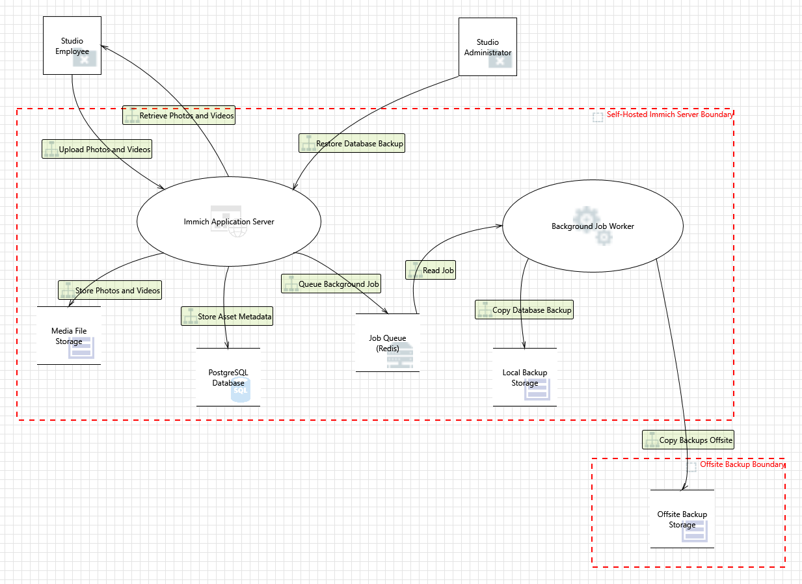

# Immich Threat Modeling Report

**Course:** Software Assurance  
**Project:** Immich Open-Source Photo Management System  
**Team:** Team 6

---

## 1. Introduction and Operational Context

### 1.1 Project Overview

Immich is an open-source, self-hosted photo and video management application that allows users to upload, organize, store, and share digital media. Since Immich handles potentially sensitive information, understanding its security risks is important for organizations considering its use.

For this assignment, Team 6 will examine Immich through data flow diagrams (DFDs) and threat modeling to identify potential security weaknesses, evaluate possible mitigations, and determine whether existing security controls adequately address the identified threats.

### 1.2 Operational Environment

Our team is continuing with the hypothetical professional photography studio introduced in our previous assignments. The studio employs five staff members who use Immich to manage client photographs and videos.

The assumed deployment includes web and mobile clients, an application server accessed through a reverse proxy, a PostgreSQL database, and file storage. Studio employees upload, organize, retrieve, and share client media, while an administrator manages the deployment. External clients may also access selected media through sharing links.

Because the studio manages private client information, unauthorized access, disclosure of photographs, modification of stored data, and service interruptions could negatively affect operations and client trust.

### 1.3 Threat Modeling Objectives

The purpose of this assignment is to identify potential security threats within Immich by examining how data moves between users, application components, and storage systems.

Our objectives are to:

- Develop Level 1 or Level 2 DFDs representing critical data flows.
- Identify trust boundaries and interactions that may introduce security risks.
- Use Microsoft's Threat Modeling Tool to identify potential STRIDE threats.
- Evaluate the relevance of generated threats and propose appropriate mitigations.
- Examine Immich's existing security controls and identify gaps requiring additional protection or verification.

The results will help us better understand how the security concerns identified in our previous assignments relate to Immich's architecture and data flows.

### 1.4 Scope and Assumptions

The threat modeling exercise focuses on the five security areas identified in our previous assurance case:

1. Authentication and Account Access
2. Photo/Video Access and Authorization
3. Network Communication Security
4. Stored Data Security
5. Availability and Data Preservation

The analysis considers our hypothetical studio deployment rather than every possible Immich configuration. We will examine relevant application components, user interactions, data flows, and trust boundaries.

Threats identified during this assignment represent potential security risks and do not necessarily indicate confirmed vulnerabilities in Immich. Additional investigation, configuration review, or testing may be required to determine whether specific threats are adequately mitigated.

---

## 2. Threat Modeling Methodology

### 2.1 Microsoft Threat Modeling Tool

Team 6 will use Microsoft's Threat Modeling Tool (TMT) to develop and analyze DFDs representing critical interactions within Immich.

The diagrams will identify external entities, processes, data stores, data flows, and trust boundaries. Each diagram will focus on the security scenarios established in our previous use/misuse case and assurance case assignments.

After creating the diagrams, we will use TMT to automatically generate potential threats. Each generated threat will be reviewed to determine whether it is relevant to the modeled system. For relevant threats, we will document proposed mitigation strategies and explain how they address the identified risks.

Full HTML reports generated by TMT will be included in the GitHub repository and linked from this report.

### 2.2 STRIDE Threat Categories

The threat analysis will use the STRIDE framework to examine six categories of security threats:

| Category | Description |
|---|---|
| Spoofing | An attacker impersonates a legitimate user, service, or system component. |
| Tampering | An attacker modifies information or system components without authorization. |
| Repudiation | A user or attacker denies performing an action because sufficient evidence is unavailable. |
| Information Disclosure | Sensitive information becomes accessible to unauthorized individuals or systems. |
| Denial of Service | An attacker disrupts the availability of a system or service. |
| Elevation of Privilege | An attacker gains permissions or access beyond what they are authorized to have. |

These categories provide a structured way to examine potential security weaknesses associated with the system's components and interactions.

### 2.3 Trust Boundaries

Trust boundaries separate components or environments with different levels of trust. Data crossing these boundaries may require additional security controls to prevent unauthorized access, modification, or disclosure.

For the assumed Immich deployment, potential trust boundaries include:

- External users and the studio's publicly accessible application entry point.
- The reverse proxy and internal application services.
- Application services and the PostgreSQL database.
- Application services and stored media files.
- Administrative operations and regular user operations.

The exact boundaries will be represented in the DFDs based on the components and interactions included in each scenario.

Particular attention will be given to interactions crossing trust boundaries because these may introduce opportunities for attackers to exploit differences in authentication, authorization, or network access.

### 2.4 Diagram Organization

Each team member is responsible for the security area assigned in our previous assurance case assignment.

Members may develop individual DFDs or collaborate on shared diagrams when their scenarios overlap. When diagrams are combined, the participating members will coordinate their contributions to ensure that all relevant data flows and security concerns are addressed.

The final report will include the applicable diagrams, relevant TMT-generated threats, proposed mitigations, and links to the exported HTML reports.

---

## 3. Data Flow Diagrams and Threat Analysis

Each team member is responsible for documenting their assigned security area.

For each diagram:
- Identify the relevant data flows and system components.
- Include the Level 1 or Level 2 DFD.
- Identify important trust boundaries.
- Review the threats automatically generated by TMT.
- Document relevant threats and proposed mitigations.
- Explain why any significant generated threats were considered not applicable.
- Provide a link to the full HTML report.

### 3.1 Authentication and Account Access

**Owner:** Christian Theisen

#### 3.1.1 Scenario Overview

[Describe the authentication, login, account access, and session-management scenarios.]

#### 3.1.2 DFD and Data Flows

[Insert the DFD image exported from TMT.]

[Explain the external entities, processes, data stores, data flows, and trust boundaries.]

#### 3.1.3 TMT-Generated Threats

| Threat ID | STRIDE Category | Affected Element / Flow | Threat Description | Relevance |
|---|---|---|---|---|
| TBD | TBD | TBD | TBD | TBD |

#### 3.1.4 Proposed Mitigations

| Threat ID | Proposed Mitigation | Rationale |
|---|---|---|
| TBD | TBD | TBD |

#### 3.1.5 HTML Threat Modeling Report

[View Authentication TMT Report](reports/authentication-report.html)

---

### 3.2 Photo/Video Access and Authorization

**Owner:** Adu

#### 3.2.1 Scenario Overview

[Describe private asset access, media authorization, shared links, and protected photo/video retrieval.]

#### 3.2.2 DFD and Data Flows

[Describe relevant components, flows, and trust boundaries.]

#### 3.2.3 TMT-Generated Threats

| Threat ID | STRIDE Category | Affected Element / Flow | Threat Description | Relevance |
|---|---|---|---|---|
| TBD | TBD | TBD | TBD | TBD |

#### 3.2.4 Proposed Mitigations

| Threat ID | Proposed Mitigation | Rationale |
|---|---|---|
| TBD | TBD | TBD |

#### 3.2.5 HTML Threat Modeling Report

[View Asset Authorization TMT Report](reports/asset-authorization-report.html)

---

### 3.3 Network Communication Security

**Owner:** Marc

#### 3.3.1 Scenario Overview

[Describe network communication between clients, the reverse proxy, application server, and internal services.]

#### 3.3.2 DFD and Data Flows

[Describe relevant components, flows, and trust boundaries.]

#### 3.3.3 TMT-Generated Threats

| Threat ID | STRIDE Category | Affected Element / Flow | Threat Description | Relevance |
|---|---|---|---|---|
| TBD | TBD | TBD | TBD | TBD |

#### 3.3.4 Proposed Mitigations

| Threat ID | Proposed Mitigation | Rationale |
|---|---|---|
| TBD | TBD | TBD |

#### 3.3.5 HTML Threat Modeling Report

[View Network Communication TMT Report](reports/network-communication-report.html)

---

### 3.4 Stored Data Security

**Owner:** Dillon

#### 3.4.1 Scenario Overview

[Describe database operations, media storage, stored asset retrieval, and unauthorized data modification.]

#### 3.4.2 DFD and Data Flows

[Describe relevant components, flows, and trust boundaries.]

#### 3.4.3 TMT-Generated Threats

| Threat ID | STRIDE Category | Affected Element / Flow | Threat Description | Relevance |
|---|---|---|---|---|
| TBD | TBD | TBD | TBD | TBD |

#### 3.4.4 Proposed Mitigations

| Threat ID | Proposed Mitigation | Rationale |
|---|---|---|
| TBD | TBD | TBD |

#### 3.4.5 HTML Threat Modeling Report

[View Stored Data TMT Report](reports/stored-data-report.html)

---

### 3.5 Availability and Data Preservation

**Owner:** Matthew

#### 3.5.1 Scenario Overview

[Describe media availability, backups, recovery, system failures, and data preservation.]

#### 3.5.2 DFD and Data Flows

[Describe relevant components, flows, and trust boundaries.]

#### 3.5.3 TMT-Generated Threats

| Threat ID | STRIDE Category | Affected Element / Flow | Threat Description | Relevance |
|---|---|---|---|---|
| TBD | TBD | TBD | TBD | TBD |

#### 3.5.4 Proposed Mitigations

| Threat ID | Proposed Mitigation | Rationale |
|---|---|---|
| TBD | TBD | TBD |

#### 3.5.5 HTML Threat Modeling Report

[View Availability TMT Report](reports/availability-report.html)

---

## 4. Existing Security Controls and Gap Analysis

For each security area, review the Immich project for evidence of relevant security controls.

Distinguish between:
- Controls documented or implemented by Immich.
- Controls requiring deployment-specific configuration.
- Controls that could not be verified.
- Missing or insufficient mitigations.

### 4.1 Authentication and Account Access

**Owner:** Christian Theisen

#### Existing Security Controls

[Document relevant authentication and session-management controls found in Immich.]

#### Identified Security Gaps

[Identify missing, incomplete, or unverified mitigations.]

#### Recommended Improvements

[Describe additional security measures, testing, or configuration changes.]

---

### 4.2 Photo/Video Access and Authorization

**Owner:** Adu

#### Existing Security Controls

[Document relevant media authorization and sharing controls.]

#### Identified Security Gaps

[Identify missing, incomplete, or unverified mitigations.]

#### Recommended Improvements

[Describe recommended improvements.]

---

### 4.3 Network Communication Security

**Owner:** Marc

#### Existing Security Controls

[Document relevant HTTPS, proxy, certificate, and network controls.]

#### Identified Security Gaps

[Identify missing, incomplete, or unverified mitigations.]

#### Recommended Improvements

[Describe recommended improvements.]

---

### 4.4 Stored Data Security

**Owner:** Dillon

#### Existing Security Controls

[Document relevant storage permissions, database access, and data protection controls.]

#### Identified Security Gaps

[Identify missing, incomplete, or unverified mitigations.]

#### Recommended Improvements

[Describe recommended improvements.]

---

### 4.5 Availability and Data Preservation

**Owner:** Matthew

#### Existing Security Controls

[Document relevant backup, recovery, integrity, and availability mechanisms.]

#### Identified Security Gaps

[Identify missing, incomplete, or unverified mitigations.]

#### Recommended Improvements

[Describe recommended improvements.]

---

## 5. Optional AI-Assisted Threat Analysis

**Note:** This section is optional and does not replace the required Microsoft Threat Modeling Tool analysis.

### 5.1 AI Analysis Method

[Document the AI tool, prompt, and DFD used, if applicable.]

### 5.2 AI-Identified STRIDE Threats

[Summarize threats identified through AI analysis.]

### 5.3 Comparison with TMT Results

[Compare threats and mitigations identified by AI against those generated by TMT.]

### 5.4 Reflection on AI Usefulness

[Discuss strengths, limitations, and differences between the approaches.]

---

## 6. Team Reflection

### 6.1 Individual Reflections

**Christian Theisen:**

[What did you learn? What was most useful?]

**Adu:**

[Individual reflection.]

**Marc:**

[Individual reflection.]

**Dillon:**

[Individual reflection.]

**Matthew:**

[Individual reflection.]

### 6.2 Combined Team Reflection

[Summarize what the team learned from developing DFDs, analyzing STRIDE threats, identifying mitigations, and evaluating existing security controls.]

[Discuss the importance of trust boundaries and how threat modeling contributed to understanding Immich's security.]

[Describe any challenges encountered and lessons learned through collaboration.]

---

## 7. GitHub Collaboration

**Repository:** https://github.com/marc-fayad/team6-immich

**Project Board:** https://github.com/users/marc-fayad/projects/1

### 7.1 Task Assignments

| Team Member | Assigned Security Area |
|---|---|
| Christian | Authentication and Account Access |
| Adu | Photo/Video Access and Authorization |
| Marc | Network Communication Security |
| Dillon | Stored Data Security |
| Matthew | Availability and Data Preservation |

### 7.2 Collaboration Summary

[Describe how the team coordinated through GitHub issues, branches, pull requests, and project board updates.]

[Identify any shared diagrams or collaborative threat analysis.]

---

## 8. References

1. Team 6. *Immich Software Assurance Case.*
   [Previous Team Report](ASSURANCE_CASE_REPORT.md).

2. Immich Contributors. *Immich — Open-Source Photo and Video Management.*
   https://github.com/immich-app/immich

3. Immich. *Official Documentation.*
   https://docs.immich.app/

4. Microsoft. *Threat Modeling Tool Overview.*
   https://learn.microsoft.com/en-us/azure/security/develop/threat-modeling-tool

5. Microsoft. *Threat Modeling Tool — Getting Started.*
   https://learn.microsoft.com/en-us/azure/security/develop/threat-modeling-tool-getting-started

6. Microsoft. *Threat Modeling Tool Download.*
   https://aka.ms/threatmodelingtool
