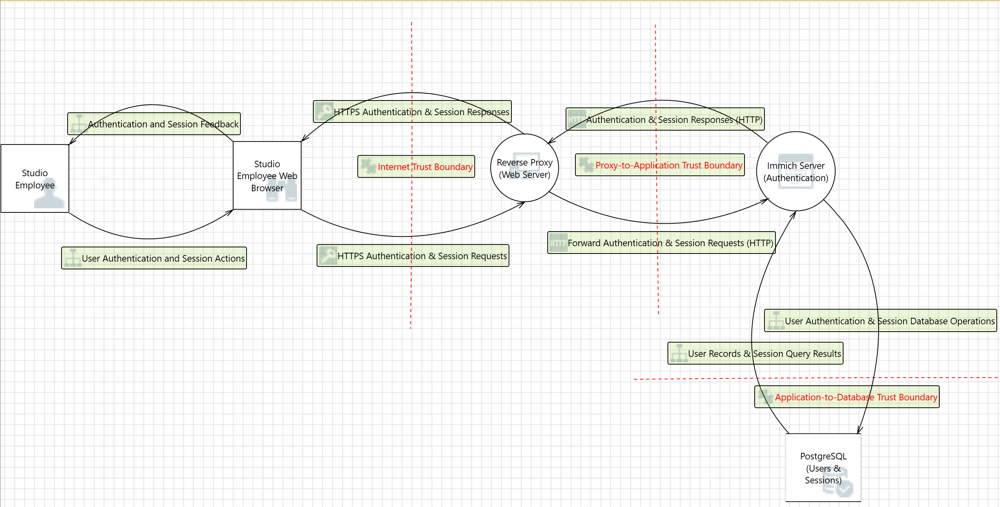
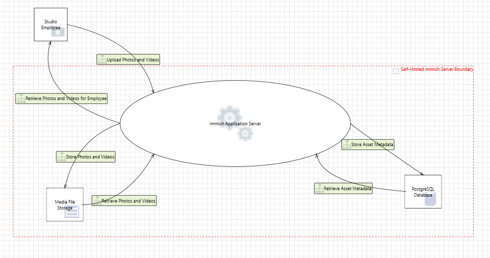

# Immich Threat Modeling Report

**Course:** Software Assurance  
**Project:** Immich Open-Source Photo Management System  
**Team:** Team 6

---

## 1. Introduction and Operational Context

### 1.1 Project Overview

Immich is an open-source, self-hosted photo and video management application that allows users to upload, organize, store, and share digital media. Since Immich handles potentially sensitive information, understanding its security risks is important for organizations considering its use.

For this assignment, Team 6 will examine Immich through data flow diagrams (DFDs) and threat modeling to identify potential security weaknesses, evaluate possible mitigations, and determine whether existing security controls adequately address the identified threats.

### 1.2 Operational Environment

Our team is continuing with the hypothetical professional photography studio introduced in our previous assignments. The studio employs five staff members who use Immich to manage client photographs and videos.

The assumed deployment includes web and mobile clients, an application server accessed through a reverse proxy, a PostgreSQL database, and file storage. Studio employees upload, organize, retrieve, and share client media, while an administrator manages the deployment. External clients may also access selected media through sharing links.

Because the studio manages private client information, unauthorized access, disclosure of photographs, modification of stored data, and service interruptions could negatively affect operations and client trust.

### 1.3 Threat Modeling Objectives

The purpose of this assignment is to identify potential security threats within Immich by examining how data moves between users, application components, and storage systems.

Our objectives are to:

- Develop Level 1 or Level 2 DFDs representing critical data flows.
- Identify trust boundaries and interactions that may introduce security risks.
- Use Microsoft's Threat Modeling Tool to identify potential STRIDE threats.
- Evaluate the relevance of generated threats and propose appropriate mitigations.
- Examine Immich's existing security controls and identify gaps requiring additional protection or verification.

The results will help us better understand how the security concerns identified in our previous assignments relate to Immich's architecture and data flows.

### 1.4 Scope and Assumptions

The threat modeling exercise focuses on the five security areas identified in our previous assurance case:

1. Authentication and Account Access
2. Photo/Video Access and Authorization
3. Network Communication Security
4. Stored Data Security
5. Availability and Data Preservation

The analysis considers our hypothetical studio deployment rather than every possible Immich configuration. We will examine relevant application components, user interactions, data flows, and trust boundaries.

Threats identified during this assignment represent potential security risks and do not necessarily indicate confirmed vulnerabilities in Immich. Additional investigation, configuration review, or testing may be required to determine whether specific threats are adequately mitigated.

---

## 2. Threat Modeling Methodology

### 2.1 Microsoft Threat Modeling Tool

Team 6 will use Microsoft's Threat Modeling Tool (TMT) to develop and analyze DFDs representing critical interactions within Immich.

The diagrams will identify external entities, processes, data stores, data flows, and trust boundaries. Each diagram will focus on the security scenarios established in our previous use/misuse case and assurance case assignments.

After creating the diagrams, we will use TMT to automatically generate potential threats. Each generated threat will be reviewed to determine whether it is relevant to the modeled system. For relevant threats, we will document proposed mitigation strategies and explain how they address the identified risks.

Full HTML reports generated by TMT will be included in the GitHub repository and linked from this report.

### 2.2 STRIDE Threat Categories

The threat analysis will use the STRIDE framework to examine six categories of security threats:

| Category | Description |
|---|---|
| Spoofing | An attacker impersonates a legitimate user, service, or system component. |
| Tampering | An attacker modifies information or system components without authorization. |
| Repudiation | A user or attacker denies performing an action because sufficient evidence is unavailable. |
| Information Disclosure | Sensitive information becomes accessible to unauthorized individuals or systems. |
| Denial of Service | An attacker disrupts the availability of a system or service. |
| Elevation of Privilege | An attacker gains permissions or access beyond what they are authorized to have. |

These categories provide a structured way to examine potential security weaknesses associated with the system's components and interactions.

### 2.3 Trust Boundaries

Trust boundaries separate components or environments with different levels of trust. Data crossing these boundaries may require additional security controls to prevent unauthorized access, modification, or disclosure.

For the assumed Immich deployment, potential trust boundaries include:

- External users and the studio's publicly accessible application entry point.
- The reverse proxy and internal application services.
- Application services and the PostgreSQL database.
- Application services and stored media files.
- Administrative operations and regular user operations.

The exact boundaries will be represented in the DFDs based on the components and interactions included in each scenario.

Particular attention will be given to interactions crossing trust boundaries because these may introduce opportunities for attackers to exploit differences in authentication, authorization, or network access.

### 2.4 Diagram Organization

Each team member is responsible for the security area assigned in our previous assurance case assignment.

Members may develop individual DFDs or collaborate on shared diagrams when their scenarios overlap. When diagrams are combined, the participating members will coordinate their contributions to ensure that all relevant data flows and security concerns are addressed.

The final report will include the applicable diagrams, relevant TMT-generated threats, proposed mitigations, and links to the exported HTML reports.

---

## 3. Data Flow Diagrams and Threat Analysis

Each team member is responsible for documenting their assigned security area.

For each diagram:
- Identify the relevant data flows and system components.
- Include the Level 1 or Level 2 DFD.
- Identify important trust boundaries.
- Review the threats automatically generated by TMT.
- Document relevant threats and proposed mitigations.
- Explain why any significant generated threats were considered not applicable.
- Provide a link to the full HTML report.

### 3.1 Authentication and Account Access

**Owner:** Christian Theisen

#### 3.1.1 Scenario Overview

This scenario examines authentication and session management within the hypothetical professional photography studio's Immich deployment. Studio employees use a web browser to sign in, access authenticated application functionality, and sign out when finished. The Immich server processes authentication requests and uses PostgreSQL to retrieve user and session information.

The analysis considers the confidentiality of credentials and session tokens, the integrity of authentication requests, and the availability of authentication services. It also examines whether requests can cross trust boundaries without appropriate protections.

#### 3.1.2 DFD and Data Flows

The Level 1 DFD contains five components:

| Component | Role |
|---|---|
| Studio Employee | User who initiates authentication and session actions |
| Studio Employee Web Browser | Client that sends requests and receives authentication responses |
| Reverse Proxy (Web Server) | Entry point for HTTPS requests and intermediary for application traffic |
| Immich Server (Authentication) | Processes authentication requests and validates sessions |
| PostgreSQL (Users & Sessions) | Stores user and session records |

The diagram models eight directional data flows:

| Source → Destination | Data Flow |
|---|---|
| Studio Employee → Web Browser | User Authentication and Session Actions |
| Web Browser → Studio Employee | Authentication and Session Feedback |
| Web Browser → Reverse Proxy | HTTPS Authentication & Session Requests |
| Reverse Proxy → Web Browser | HTTPS Authentication & Session Responses |
| Reverse Proxy → Immich Server | Forward Authentication & Session Requests (HTTP) |
| Immich Server → Reverse Proxy | Authentication & Session Responses (HTTP) |
| Immich Server → PostgreSQL | User Authentication & Session Database Operations |
| PostgreSQL → Immich Server | User Records & Session Query Results |

The DFD identifies three trust boundaries:

1. **Internet Trust Boundary:** Separates the employee's browser from the reverse proxy. HTTPS protects communication in transit, while application authentication is still required to establish user identity.
2. **Proxy-to-Application Trust Boundary:** Separates the reverse proxy from the Immich authentication service. The modeled connection uses HTTP, making network isolation and appropriate transport protection important.
3. **Application-to-Database Trust Boundary:** Separates the authentication service from PostgreSQL. Database access controls and secure query handling are important for protecting user and session records.

The original diagram used 18 individual data flows. These were consolidated into eight directional flows to improve readability and reduce repetitive TMT findings while preserving the main authentication, session-validation, and logout interactions.

The DFD represents an assumed studio deployment. Individual network and transport protections must be verified against the actual configuration.

#### 3.1.3 TMT-Generated Threats

Microsoft Threat Modeling Tool generated **59 potential threats** for the simplified authentication DFD. Seven representative findings were selected for closer analysis, covering all six STRIDE categories.

| Threat ID | STRIDE Category | Affected Element / Flow | Threat Description | Relevance |
|---|---|---|---|---|
| 6 | Spoofing | Browser → Reverse Proxy | An attacker could impersonate a legitimate employee browser. | Relevant: stolen credentials or sessions could enable unauthorized access. |
| 9 | Tampering | Immich Server → PostgreSQL | Unsafe database query construction could allow SQL injection. | Relevant for investigation; no SQL injection vulnerability was confirmed. |
| 22 | Repudiation | Browser → Reverse Proxy | Insufficient records could make it difficult to establish whether the proxy received an authentication request. | Relevant: authentication activity requires appropriate logging and audit evidence. |
| 219 | Information Disclosure | Reverse Proxy → Immich Server | Authentication traffic could be intercepted on the modeled HTTP connection. | Relevant if an attacker can access the internal network path. |
| 220 | Information Disclosure | Reverse Proxy → Immich Server | Intercepted credentials or reusable session tokens could be exposed or replayed. | Relevant because sensitive authentication data may traverse the modeled HTTP connection. |
| 10 | Denial of Service | Immich Server → PostgreSQL | Excessive authentication or database resource consumption could disrupt service. | Relevant: resource exhaustion could prevent legitimate employee access. |
| 2 | Elevation of Privilege | Browser → Reverse Proxy | The reverse proxy could improperly impersonate a browser's security context. | Relevant for investigation of proxy trust and authorization boundaries. |

All 59 generated findings were initially assigned High priority by TMT. These are automatically generated potential threats, not 59 confirmed high-severity vulnerabilities.

The selected findings were documented in the TMT model with justifications and recommended controls. Their statuses remain Not Started because the proposed mitigations have not been validated for the hypothetical deployment.

#### 3.1.4 Proposed Mitigations

| Threat ID | Proposed Mitigation | Rationale |
|---|---|---|
| 6 | Enforce secure authentication, server-side session validation, session expiration and revocation, and secure cookie settings. | Reduces the likelihood of unauthorized access through impersonation or compromised sessions. |
| 9 | Use parameterized queries, safe database access methods, input validation, and least-privilege database permissions. | Reduces opportunities for SQL injection and limits potential database impact. |
| 22 | Maintain protected, timestamped reverse proxy access logs and authentication event records without recording sensitive credentials or tokens. | Improves accountability and investigation of disputed authentication activity. |
| 219 | Isolate the internal application network and use authenticated TLS on upstream connections where supported and appropriate. | Reduces the risk of interception of authentication traffic. |
| 220 | Protect credentials and session tokens in transit, restrict internal network access, and enforce secure session management. | Reduces credential exposure and potential replay attacks. |
| 10 | Apply rate limiting, connection and resource limits, timeouts, and monitoring for abnormal authentication activity. | Helps maintain service availability under excessive request loads. |
| 2 | Enforce authentication and authorization within the application, restrict proxy privileges, and validate trusted identity headers. | Prevents improper assumptions of user identity or privilege across the proxy boundary. |

These mitigations are recommendations based on the modeled threats. Some protections may already be implemented by Immich, while others depend on the studio's deployment configuration. Their implementation and effectiveness are evaluated further in Section 4.1.

#### 3.1.5 HTML Threat Modeling Report

[View Authentication TMT Report](reports/authentication-report.html)

The exported HTML report contains the authentication DFD, all 59 generated threats, and the seven representative findings documented with justifications.

---

### 3.2 Photo/Video Access and Authorization

**Owner:** Adu

#### 3.2.1 Scenario Overview

[Describe private asset access, media authorization, shared links, and protected photo/video retrieval.]
a) Accessing Private Media Assets

When uploading media (photos/videos), users have the option to make it private. If an asset is private it should only be visible by its owner or users given access. When trying to access private media from a user, the Immich server must confirm that they have permission to view this asset.

b) Media Authorization

Access control will ensure users can only carry out actions based on permissions given through ownership and sharing. Access control should be enforced at the server side. This needs to be enforced for original media, thumbnail images, metadata, downloadable media and search results. For example, if user A tries to access private media from user B, but user B hasn’t given them the correct permissions, the request should be denied.

c) Shared Links

Users can share some of their media without giving full access to their private media. Within Immich, there are two key methods for sharing media:
Internal Sharing: Users can share an album with another Immich user. The user can be given either viewing or editing permissions.
Public Shared Links: Users can generate public links to specific assets/ albums. When doing this, users can set an expiry date, password, and permitted actions.

d) Secure Media Access

Secure media access means that media can only be accessed once authorisation has been confirmed.

#### 3.2.2 DFD and Data Flows

[Describe relevant components, flows, and trust boundaries.]

Photo/Video Access and Authorization
Components
The following components implement the Photo/Video Access and Authorization process in Immich.
Component Description

E1: Immich User
User requesting to upload, view, download, and share photos and videos.

P1: Immich API
Handles requests from the user.

P2: Authentication
Verifies user identity.

P3: Authorization
Verifies if the user is the owner of an asset, has permission to share an asset, or has permission to access a shared link.

P4: Media Access/Upload
Handles authorized uploading, accessing and downloading of media.

D1: PostgreSQL Database
Stores user details, asset details, ownership, and access rights.

D2: Media Storage
Stores raw media (photos and videos) and thumbnails.

Data Flows
In this DFD, the following Data Flows take place.

1.User Request: User requests to upload, access, or share media.

2.Authentication: The authentication component verifies the user by receiving authentication details from the API.

3.Authorization: Authorization checks are carried out to ensure that the user has ownership and permission to share the asset.

4.Database: Ownership details, asset details, and access rights are retrieved from the PostgreSQL database.

5.Media Storage: Permitted media actions are carried out on the protected media storage, including accessing and uploading media.

6.Response: The permitted content is returned to permitted users. If the request was not permitted, the request is denied.

Trust Boundaries
Within this DFD there are three significant trust boundaries.

Trust Boundary Description Concerns
TB1: Untrusted External Clients

Boundary between the Immich users/client devices and the application.
Spoofing, session hijacking, malicious requests, and unauthorized access.

TB2: Trusted Immich Application

Includes the API, authentication, authorization, and media access processes.
Privilege escalation, authorization bypass, and impersonation.

TB3: Protected Data Store

Boundary between the application processes and the PostgreSQL database/media storage.
Data modification, information exposure, spoofed data stores, and denial of service.
The most critical trust boundaries are between the user requests and the API, and between the application processes and the PostgreSQL database/protected media storage. Strong authentication, authorization on the server, limited access rights, and secure communication should be implemented at these points.

#### 3.2.3 TMT-Generated Threats

| Threat ID | STRIDE Category | Affected Element / Flow | Threat Description | Relevance |
|---|---|---|---|---|
| TBD | TBD | TBD | TBD | TBD |

#### 3.2.4 Proposed Mitigations

| Threat ID | Proposed Mitigation | Rationale |
|---|---|---|
| TBD | TBD | TBD |

#### 3.2.5 HTML Threat Modeling Report

[View Asset Authorization TMT Report](reports/asset-authorization-report.html)

https://apeprah1.github.io/PhotoVideo_Access_Threat_Model_Report.htm/
---

### 3.3 Network Communication Security

**Owner:** Marc

#### 3.3.1 Scenario Overview

Studio staff use the Immich web and mobile clients to sign in, upload photographs and videos, and retrieve client media. External clients use share links to retrieve selected media. These requests cross the public network to the studio's reverse proxy, which terminates HTTPS and forwards requests to the Immich application server. The server exchanges data with internal services while processing those requests. Login credentials, session tokens, sharing links, media, and metadata require confidentiality and integrity in transit. This scenario supports assurance claim NC0.

#### 3.3.2 DFD and Data Flows

The following flows define the network communication scope for the proposed studio deployment. The diagram reviewed places the reverse proxy and Immich server in a shared trust zone and PostgreSQL in a separate zone. The proxy terminates public HTTPS. The two internal HTTP flows were visible in the diagram screenshot and produced no rows in the revised CSV. Their endpoint attachments in the final editable model still need verification.

| Source and destination | Data in transit | Trust boundary |
| --- | --- | --- |
| Staff browser or mobile client ↔ reverse proxy | Sign-in requests, session data, API requests, and media uploads and downloads | Public network to studio ingress |
| External client browser ↔ reverse proxy | Share-link requests and selected media responses | Public network to studio ingress |
| Reverse proxy ↔ Immich server | Forwarded requests and responses, including proxy headers, session data, and media | Within the shared proxy and application zone |
| Immich server ↔ PostgreSQL | Database authentication, queries and updates, and metadata returned to the server | Application network to internal data service |

#### 3.3.3 TMT-Generated Threats

The revised TMT export contains 40 entries across six interactions. The table records the relevance decision for each ID. Repeated template entries share a rationale. The relevance decisions below are based on the exported descriptions and are ready to enter in the editable TMT model.

| Threat IDs | STRIDE category | Affected element or flow | Threat description | Relevance and rationale |
| --- | --- | --- | --- | --- |
| 1 | Information Disclosure | Staff client → reverse proxy | Interception of mobile client traffic can disclose credentials, API data, and private uploads. | Relevant. Public transport security and server identity protect sensitive data on this flow. |
| 0 | Elevation of Privileges | Staff mobile device | Jailbreaking or rooting can elevate privileges on the device. | Outside scope. The threat concerns device privilege and integrity. |
| 2 | Information Disclosure | Staff mobile device | Sensitive data may be exposed from local storage. | Outside scope. The described exposure concerns data at rest. |
| 3 | Tampering | Staff mobile application | Reverse engineering and modification of mobile binaries. | Outside scope. The described action concerns the integrity of the installed application. |
| 19, 25, 31, 37, 43, 49 | Elevation of Privileges | Host machines on staff HTTPS, sharing HTTPS, and PostgreSQL flows | Unauthorized access to host data. | Outside scope as described. The template refers to access on a host. The database network exposure is evaluated separately below. |
| 20, 26, 32, 38, 44, 50 | Elevation of Privileges | Same six directed flows | Elevated privileges and malicious code execution on a host. | Outside scope. These entries concern host execution privileges. |
| 21, 27, 33, 39, 45, 51 | Information Disclosure | Same six directed flows | Disclosure of sensitive data stored on a host. | Outside scope. These entries concern stored data. |
| 22, 28, 34, 40, 46, 52 | Tampering | Same six directed flows | Endpoint malware may steal or modify data. | Outside scope. The stated control is endpoint protection. |
| 23, 29, 35, 41, 47, 53 | Tampering | Same six directed flows | Reverse engineering of deployed binaries. | Outside scope. The described activity concerns deployed software. |
| 24, 30, 36, 42, 48, 54 | Tampering | Same six directed flows | Modification of deployed binaries. | Outside scope. These entries concern software integrity. |

#### 3.3.4 Proposed Mitigations

The first row maps to a generated TMT ID. The other rows document deployment risks identified through review of the DFD and use descriptive finding names.

| Threat ID or manual finding | Proposed mitigation | Rationale |
| --- | --- | --- |
| TMT 1 — Public traffic disclosure | Require HTTPS for staff sign-in, API calls, and uploads. Use a certificate valid for the studio hostname and verify that supported clients reject invalid certificates. Apply the same public HTTPS configuration to downloads and share-link routes. | TLS protects data in transit and lets clients verify the identity of the studio endpoint. |
| Internal HTTP — Information disclosure and tampering | Limit upstream access to the reverse proxy. Configure the proxy to set forwarding headers and the application to trust them only from authorized proxies. Use certificate-validated TLS if the upstream path crosses a shared or untrusted network. | Forwarded requests and responses can contain credentials, session data, share links, or media. Network restrictions reduce access to the path, and authenticated TLS protects traffic across the path. |
| PostgreSQL transport and access — Information disclosure and tampering | Restrict PostgreSQL connectivity to authorized services and use an application database account with the permissions Immich requires. Verify the connection's transport settings and require TLS with server identity verification across shared or untrusted networks. | Queries, updates, and returned metadata require confidentiality and integrity. Network controls and database authentication restrict who can connect. |

#### 3.3.5 HTML Threat Modeling Report

[View Network Communication TMT Report](https://htmlpreview.github.io/?https://github.com/marc-fayad/team6-immich/blob/main/reports/network-communication-report.html) · [HTML source](reports/network-communication-report.html)

*The preview targets the final submission on the main branch. Both links depend on the TMT export being committed and merged.*

---

### 3.4 Stored Data Security

**Owner:** Dillon

#### 3.4.1 Scenario Overview

This scenario focuses on how Immich stores and retrieves photos, videos, and their associated metadata. For a small photography studio, protecting stored data is important because employees need to access and manage client photos without exposing private information or allowing unauthorized changes.

Immich uses filesystem storage for photos and videos and PostgreSQL for application data and asset metadata. The main security concerns include unauthorized database access, excessive database permissions, sensitive information disclosure, SQL injection, and unauthorized modification of stored information.

The goal of this threat model is to identify potential risks involving the storage components and determine how those risks could be reduced.

#### 3.4.2 DFD and Data Flows

The data flow diagram was created using Microsoft Threat Modeling Tool and includes the following components:

- **Studio Employee:** The external user who uploads and retrieves photos and videos.
- **Immich Application Server:** Processes requests and communicates with the storage systems.
- **Media File Storage:** Stores the original photos and videos.
- **PostgreSQL Database:** Stores application data and asset metadata.
- **Self-Hosted Immich Server Boundary:** Represents the trust boundary around the server-side components.

The diagram includes six data flows:

1. Upload Photos and Videos
2. Retrieve Photos and Videos for Employee
3. Store Photos and Videos
4. Retrieve Photos and Videos
5. Store Asset Metadata
6. Retrieve Asset Metadata

The main trust boundary separates the studio employee from the self-hosted Immich server and its internal storage components.

#### 3.4.3 TMT-Generated Threats

Microsoft Threat Modeling Tool generated seven potential threats associated with the Store Asset Metadata interaction. These represent possible security risks rather than confirmed vulnerabilities in Immich.

| Threat ID | STRIDE Category | Affected Element / Flow | Threat Description | Relevance |
|---|---|---|---|---|
| T1 | Elevation of Privilege | Store Asset Metadata | Unauthorized database access through exposed network connections | Could allow attackers to access PostgreSQL |
| T2 | Elevation of Privilege | Store Asset Metadata | Database accounts have excessive permissions | Could allow unauthorized access to sensitive records |
| T3 | Information Disclosure | Store Asset Metadata | Sensitive database information could be exposed | Could expose photo metadata and application information |
| T4 | Information Disclosure | Store Asset Metadata | SQL injection could manipulate database queries | Could allow unauthorized reading or modification of data |
| T5 | Repudiation | Store Asset Metadata | Insufficient database auditing and logging | Could make unauthorized activity difficult to investigate |
| T6 | Tampering | Store Asset Metadata | Unauthorized modification of database records | Could compromise the integrity of stored metadata |
| T7 | Tampering | Store Asset Metadata | Insufficient monitoring of suspicious database activity | Could allow unauthorized activity to remain undetected |

*Threat IDs T1–T7 are labels used for this summary. Full threat descriptions and mitigation details are available in the exported Microsoft Threat Modeling Tool HTML report.*

#### 3.4.4 Proposed Mitigations

| Threat ID | Proposed Mitigation | Rationale |
|---|---|---|
| T1 | Restrict PostgreSQL network access to authorized application services and administrators | Reduces the risk of unauthorized database connections |
| T2 | Apply least-privilege database permissions and restrict administrative accounts | Limits the damage caused by compromised credentials |
| T3 | Protect database credentials, restrict access, and encrypt sensitive data and backups where appropriate | Reduces the risk of sensitive information disclosure |
| T4 | Use parameterized queries, validate input, and perform regular security testing | Helps prevent SQL injection attacks |
| T5 | Enable appropriate database auditing and protect security logs | Helps investigators identify unauthorized activity |
| T6 | Restrict database write permissions, validate changes, and maintain reliable backups | Helps prevent and recover from unauthorized modifications |
| T7 | Monitor unusual database activity and configure security alerts | Improves detection of suspicious database operations |

These mitigations are recommendations based on the identified threats. Some security protections are provided by Immich or PostgreSQL, while others require configuration by the organization operating the system.

#### 3.4.5 HTML Threat Modeling Report

[View Stored Data TMT Report](Immich_Stored_Data_Security_Report.htm)

The HTML report was exported from Microsoft Threat Modeling Tool and contains the data flow diagram and the seven generated threats.

---

### 3.5 Availability and Data Preservation

**Owner:** Matthew

#### 3.5.1 Scenario Overview

[Describe media availability, backups, recovery, system failures, and data preservation.]

#### 3.5.2 DFD and Data Flows

[Describe relevant components, flows, and trust boundaries.]

#### 3.5.3 TMT-Generated Threats

| Threat ID | STRIDE Category | Affected Element / Flow | Threat Description | Relevance |
|---|---|---|---|---|
| TBD | TBD | TBD | TBD | TBD |

#### 3.5.4 Proposed Mitigations

| Threat ID | Proposed Mitigation | Rationale |
|---|---|---|
| TBD | TBD | TBD |

#### 3.5.5 HTML Threat Modeling Report

[View Availability TMT Report](reports/availability-report.html)

---

## 4. Existing Security Controls and Gap Analysis

For each security area, review the Immich project for evidence of relevant security controls.

Distinguish between:
- Controls documented or implemented by Immich.
- Controls requiring deployment-specific configuration.
- Controls that could not be verified.
- Missing or insufficient mitigations.

### 4.1 Authentication and Account Access

**Owner:** Christian Theisen

#### 4.1.1 Existing Security Controls

The Immich authentication implementation was reviewed to identify security controls relevant to the threats generated by Microsoft Threat Modeling Tool. The review focused on authentication, session management, authorization, and logging.

The following controls were identified in the Immich source code:

| Security Control | Implementation Evidence | Related Threats |
|---|---|---|
| Password verification | `AuthService.login()` uses bcrypt comparison to validate submitted passwords. A dummy hash is used for nonexistent users to reduce timing-based user enumeration. | 6 |
| Password hashing | `AuthService.changePassword()` hashes replacement passwords using bcrypt before updating the user record. | 6 |
| Session token protection | `BaseService.createLoginResponse()` generates a random session token and stores its SHA-256 hash rather than the plaintext token. | 6, 220 |
| Server-side session validation | `AuthService.validateSession()` hashes the presented token and retrieves the corresponding session record. Invalid tokens are rejected. | 6, 2 |
| Session invalidation | `AuthService.logout()` deletes the current session record and emits a session deletion event. | 6, 2 |
| Authentication event logging | Failed password-login attempts generate warning logs containing the attempted email address and client IP address. | 22 |
| Authorization checks | `AuthService` validates authentication context and applies permission checks for protected operations. | 2 |

These controls provide evidence that Immich implements several protections against authentication spoofing, session impersonation, and unauthorized access. However, the presence of these controls does not guarantee that every possible attack is prevented.

#### 4.1.2 Security Gaps and Deployment Considerations

The source-code review also identified areas where additional verification or deployment-specific protections are necessary.

| Threat ID | Potential Risk | Assessment | Recommended Action |
|---|---|---|---|
| 6 | Spoofing of an employee browser or session | Existing password verification and server-side session validation provide protections. Compromised credentials or tokens remain possible attack scenarios. | Use HTTPS, protect session cookies, apply appropriate session policies, and consider additional authentication protections. |
| 9 | SQL injection against PostgreSQL | The TMT finding identifies a potential injection risk, but this review did not establish an exploitable SQL injection vulnerability. | Review database query construction and ORM usage, verify parameterization, and restrict database permissions. |
| 22 | Repudiation of authentication requests | Failed-login warning logs exist, but comprehensive reverse-proxy access logging and log retention were not verified. | Configure protected access and audit logs, appropriate timestamps, retention policies, and monitoring. |
| 219 | Sniffing of authentication traffic | The modeled reverse-proxy-to-Immich connection uses HTTP. Its exposure depends on the actual network environment. | Isolate backend traffic and evaluate upstream TLS where supported and appropriate. |
| 220 | Exposure of credentials in transit | Session tokens are hashed before storage, but this does not encrypt tokens while they travel across the network. | Protect internal network paths, enforce secure external transport, and limit access to authentication traffic. |
| 10 | Excessive resource consumption | Application and database resource exhaustion remain potential availability threats. The relevant rate limits and resource controls were not fully verified. | Review request throttling, database connection limits, timeouts, monitoring, and resource allocation. |
| 2 | Elevation of privilege through impersonation | Server-side authentication and permission checks provide protection, but proxy trust and deployment configuration require review. | Restrict proxy permissions, validate trusted headers, and maintain application-level authorization checks. |

A particularly important distinction concerns the reverse proxy. HTTPS between the browser and reverse proxy protects external communication, but it does not automatically encrypt the connection between the reverse proxy and Immich. In the modeled deployment, that internal connection uses HTTP. This is not automatically a vulnerability when traffic is appropriately isolated, but it creates a potential interception risk if an attacker gains access to the internal network.

Similarly, hashing session tokens in the database reduces exposure if stored records are compromised, but it does not replace transport encryption or secure session handling.

#### 4.1.3 Overall Assessment

The source-code review indicates that Immich implements meaningful authentication and session-management protections, including bcrypt password verification, hashed session-token storage, server-side session validation, logout-based session invalidation, and authorization checks.

The most significant remaining concerns in the hypothetical photography studio deployment involve secure reverse-proxy configuration, internal network protection, comprehensive audit logging, resource-exhaustion defenses, and verification of database query safety.

These findings should be treated as areas for security validation and configuration review rather than confirmed vulnerabilities. The TMT-generated threats provide a structured basis for identifying risks, while the source-code review helps distinguish implemented controls from recommended or unverified protections.

#### 4.1.4 References

1. [Immich Authentication Service — auth.service.ts](https://github.com/immich-app/immich/blob/main/server/src/services/auth.service.ts)
2. [Immich Base Service — base.service.ts](https://github.com/immich-app/immich/blob/main/server/src/services/base.service.ts)
3. [Immich Authentication and Session Cookie Definitions — enum.ts](https://github.com/immich-app/immich/blob/main/server/src/enum.ts)
4. [Immich Authentication TMT Report](reports/authentication-report.html)

---

### 4.2 Photo/Video Access and Authorization

**Owner:** Adu

#### Existing Security Controls

1. Authentication: Password authentication and integration with OAuth/OIDC allows for user authentication.
2. Asset ownership: Media stored in Immich is linked to a user. This prevents unauthorized users from accessing private data.
3. Access control on server: Permission checks are used to determine if a user has view, download, edit or delete access to protected media.
4. Sharing albums: Users can be given access to albums by other authenticated users with appropriate permissions.
5. Secured sharing links: Users can share certain media with a password protected and time limited link.
6. Secured media storage: Media is stored using application managed storage. Access is restricted to prevent unauthorized users from retrieving media. These controls allow for the protection of confidentiality of private media. They address multiple STRIDE threats including Spoofing, Tampering, Information Disclosure, and Elevation of privilege.

[Document relevant media authorization and sharing controls.]

#### Identified Security Gaps
Threats identified
1. Authorization: It may not be enforced correctly at all endpoints of the APIs meaning that private data (images, videos, or metadata) could be accessed by unauthorized users.
2. Impersonation: Privilege escalation may occur between authentication, authorisation and media processes.
3. Lack of Auditing: It is not verified whether sufficient auditing is in place for uploading, editing, deletion, and sharing media.
4. Database and Data Protection: There is a potential risk of unauthorized editing of data in PostgreSQL and media, and interception of data.
5. Denial of Service: Too many uploads, downloads, and/or requests to the database could lead to a denial of service.
6. Backup and Recovery: It has not been verified whether effective backup and recovery measures are in place within the deployment of the project.
Note: These threats (or lack of mitigations) are potential threats within the system, however they are not confirmed vulnerabilities in the current deployment of Immich.

[Identify missing, incomplete, or unverified mitigations.]

Threats within the Photo/Video Access and Authorization feature have been identified within the DFD and STRIDE analysis. 
1. Authorization Incomplete: Although authorization is implemented in the application, to ensure correct authorization to access media resources is applied to all endpoints, it has not been sufficiently verified. This may mean that private photos, videos, thumbnails or metadata can be accessed by unauthorized users.
2. Privilege Escalation Incomplete: Potential privilege escalation threats have been identified within the authentication, authorization and media access features. Further testing is required to verify that these features cannot bypass access permissions.
3. Audit Logging Incomplete: Full logging of media upload, deletion, editing and sharing has not been implemented. Without a sufficient audit trail, it may be difficult to determine if unauthorized access has occurred and which user may be responsible.
4. Secure Data Storage Incomplete: Although PostgreSQL and secure data storage on the server are implemented, it has not been sufficiently verified that least privilege, secure internal communication and secure storage are all implemented.
5. DDoS Incomplete: It has not been verified that limiting media uploads, limiting request rates, limiting resource usage and limiting database connections will prevent DDoS attacks. Excess requests may cause resource exhaustion, and cause interruption to media services.
 6. Shared Link Incomplete: Password protected and time limited links can be created. However, further testing is required to ensure that once a link has expired, been revoked or is unauthorized, that private media cannot be accessed.
7. Backups Incomplete: Although backups and recovery can be performed on the database, it has not been verified that media data can be backed up and restored in this deployment.

#### Recommended Improvements

1.Ensure ownership and permissions are correctly applied in all media endpoints (including thumbnails, download, metadata and shared links).

2.Ensure secure authentication of sessions. Users should be given the least permissions possible. Ensure users cannot impersonate each other between components.

3.Ensure audit logs are implemented. These should be implemented for uploading, deleting, changing permissions and sharing assets.

4.Ensure that data in the database and media is secured. This can be done with access control, secure connections, input validation and ensuring data integrity.

5.Implement protection on resources. Upload limits, throttling, timeout and monitoring should be used to reduce the possibility of a denial of service attack.

6.Ensure secure back up. Both the PostgreSQL and media should be backed up securely, and regular restoration testing should be performed.

7.Ensure more security testing. Testing should be done for cross user permissions, security of shared links and penetration testing to ensure mitigation strategies are effective.

---

### 4.3 Network Communication Security

**Owner:** Marc

#### Existing Security Controls

Immich documents how to deploy a reverse proxy that terminates public HTTPS and forwards requests to the application server. Its example configurations specify headers for the original host, client IP, and request scheme. The upstream Docker Compose configuration supplies credentials to PostgreSQL and maps Immich's application port (2283) to the host. The studio must configure the public certificate, proxy and forwarding rules, host port binding, and network restrictions. [Immich reverse proxy documentation](https://docs.immich.app/administration/reverse-proxy/) · [Upstream Compose configuration](https://github.com/immich-app/immich/blob/main/docker/docker-compose.prod.yml)

#### Identified Security Gaps

- **Public HTTPS and proxy enforcement (TMT ID 1).** The upstream port mapping requires a deployment check. If port 2283 is reachable from outside the studio, clients may be able to bypass the proxy and its HTTPS controls. Certificate validation and trusted handling of forwarding headers have yet to be verified on the studio deployment.
- **Proxy-to-Immich HTTP (manual finding).** The DFD assumes HTTP between the reverse proxy and Immich. Credentials, session data, share links, and media on this hop can be exposed or modified if an unauthorized system can observe or alter the traffic. The studio has yet to verify isolation of this path.
- **PostgreSQL transport (manual finding).** Database credentials control access to PostgreSQL. The studio still needs evidence that only authorized services can reach it and that the connection protects queries, updates, and returned metadata where it crosses a shared or untrusted network.

#### Recommended Improvements

- Make the reverse proxy the only public entry point. Verify effective port bindings and firewall rules, including IPv6 where enabled. Verify HTTPS for login, uploads, downloads, API calls, and shared media, and confirm that supported web and mobile clients reject invalid certificates.
- Restrict the application listener to the proxy and configure forwarding headers at the trusted proxy. Use certificate-validated TLS on the upstream connection if it crosses a shared or untrusted network.
- Restrict PostgreSQL connectivity to authorized services. Verify the database connection settings and require TLS with server identity verification across shared or untrusted networks. Record these checks as evidence for assurance claim NC0.

---

### 4.4 Stored Data Security

**Owner:** Dillon

#### Existing Security Controls

Immich provides several security features that help protect stored photos, videos, and database information. Based on a review of Immich's official documentation and GitHub source code, the following controls were identified:

- **Database Access:** Immich uses PostgreSQL to store application data and photo metadata. Its recommended Docker Compose deployment does not publicly expose the database port, helping limit unauthorized network access.

- **Authentication:** Immich supports password-based authentication and OpenID Connect (OIDC), allowing administrators to control access to the application.

- **Database Query Security:** Immich uses the Kysely query builder for database operations, which supports structured query construction and can help reduce SQL injection risks when used correctly.

- **Data Backups:** Immich documents automatic database backups and restoration procedures. These help protect application data from accidental loss or corruption.

- **File Integrity:** Immich provides system integrity checks that can identify missing files, untracked files, and checksum mismatches.

- **Storage Permissions:** Immich relies on filesystem permissions and ownership settings to control access to stored media files.

These controls provide a foundation for protecting stored data, although some protections depend on how Immich is configured and deployed.

#### Identified Security Gaps

Using Microsoft Threat Modeling Tool, I identified seven potential threats related to storing asset metadata in PostgreSQL. These included unauthorized database access, excessive permissions, sensitive information disclosure, SQL injection, insufficient audit logging, unauthorized database modifications, and inadequate monitoring.

After reviewing Immich's documentation and source code, I identified several areas that may require additional security measures:

- **Database Exposure:** Although the recommended deployment does not publicly expose PostgreSQL, incorrect network configurations could still allow unauthorized connections.

- **Excessive Permissions:** PostgreSQL supports role-based permissions, but I could not verify that every Immich deployment follows the principle of least privilege.

- **Sensitive Data Protection:** I could not verify that all database files and backups are automatically encrypted at rest.

- **SQL Injection:** Immich uses a structured query builder, but this does not guarantee that every database interaction is protected against SQL injection.

- **Insufficient Logging:** I could not confirm that comprehensive database auditing is enabled by default to track unauthorized access or modifications.

- **Unauthorized Data Modification:** An attacker who gains database write access could potentially modify or delete important metadata.

- **Security Monitoring:** I could not verify that suspicious database activity automatically generates security alerts.

These are potential security gaps or areas requiring further verification, rather than confirmed vulnerabilities in Immich.

#### Recommended Improvements

Based on the threats identified and the existing security controls, I recommend the following improvements to strengthen stored data security:

- **Restrict Database Access:** Ensure PostgreSQL is accessible only to authorized application services and administrators. Use network isolation and firewall rules to prevent unnecessary exposure.

- **Apply Least Privilege:** Review database accounts and permissions to ensure users and services only have access to the information and operations they require.

- **Protect Sensitive Information:** Encrypt sensitive database files and backups where appropriate, and securely manage database credentials.

- **Prevent SQL Injection:** Continue using safe database query practices, including parameterized queries, input validation, and regular security testing.

- **Improve Audit Logging:** Configure PostgreSQL and application logging to record important security events, including unauthorized access attempts and unexpected changes.

- **Monitor Database Activity:** Implement monitoring and alerts for suspicious database connections, unusual queries, and unauthorized modifications.

- **Strengthen Backup Procedures:** Maintain separate backups of both the PostgreSQL database and the original photo and video files. Regularly test restoration procedures.

- **Protect Media Storage:** Review filesystem permissions and use Immich's integrity checks to help identify missing or modified files.

Overall, Immich provides several useful security controls, but protecting stored data also depends on how the organization configures and maintains its self-hosted environment. For a photography studio, the most important priorities are restricting database access, protecting original media files, maintaining reliable backups, and detecting suspicious activity.

---

### 4.5 Availability and Data Preservation

**Owner:** Matthew

#### Existing Security Controls

[Document relevant backup, recovery, integrity, and availability mechanisms.]

#### Identified Security Gaps

[Identify missing, incomplete, or unverified mitigations.]

#### Recommended Improvements

[Describe recommended improvements.]

---

## 5. Optional AI-Assisted Threat Analysis

**Note:** This section is optional and does not replace the required Microsoft Threat Modeling Tool analysis.

### 5.1 AI Analysis Method

[Document the AI tool, prompt, and DFD used, if applicable.]

### 5.2 AI-Identified STRIDE Threats

[Summarize threats identified through AI analysis.]

### 5.3 Comparison with TMT Results

[Compare threats and mitigations identified by AI against those generated by TMT.]

### 5.4 Reflection on AI Usefulness

[Discuss strengths, limitations, and differences between the approaches.]

---

## 6. Team Reflection

### 6.1 Individual Reflections

**Christian Theisen:**

[What did you learn? What was most useful?]

**Adu:**

[Individual reflection.]

The assignment help me to identify threats within the Photo/Video Access and Authorisation process for Immich, I learned how to secure access to sensitive user data within Immich is achieved via correct authentication, authorisation, data management and media storage.

Understanding of how to apply the STRIDE approach to help discover security threats was one key thing taken from this task. This allowed me to consider threats such as Spoofing, Tampering, Repudiation, Information Disclosure, Denial of Service and Elevation of Privilege. Considering the 19 threats identified by the Microsoft Threat Modeling Tool has allowed me to understand which system components/data flows are vulnerable to which threats.It learned how to apply theory to real-world application in terms of securing software.
As a result of this task, I am more capable of analysing a software system, discovering security threats and suggesting improvements for security. Going forwards, I aim to include threat modelling at earlier stages of software development and perform security testing to confirm that security controls have been effectively implemented to protect users and their data.

**Marc:**

For my part of this assignment, I built a data flow diagram for network communication security for Immich. It traces how sign-ins, uploads/downloads, and sharing links moves through the studio's deployment. The biggest thing I learned was to follow the data past the first security control. Staff and clients connect over HTTPS, but in our model, HTTPS ends at the reverse proxy. The next connection uses internal HTTP and can still carry session tokens and private media. Seeing those connections side by side helped me understand why each hop needs to be evaluated separately. 

Seeing the results from Microsoft Threat Modeling Tool was fascinating and also taught me how much the output depends on how I build the model. I did have an issue though. My first export had threats specific to Azure PostgreSQL and an identity server, which were outside our scenario, but I had added an Identity Server node and an Azure PostGreSQL database, which affected things. After I revised the model, those entries disappeared, but the tool still generated no threats for either direction of the proxy-to-Immich connection. I documented those risks manually because they were clear from the data flow diagram.

**Dillon:**

For this assignment, I focused on stored data security in Immich. I created a data flow diagram using Microsoft Threat Modeling Tool that showed how photos, videos, and metadata move between a studio employee, the Immich application server, media file storage, and PostgreSQL database. The tool identified seven potential threats related to database security. I reviewed these threats, proposed mitigations, and researched Immich's existing security controls using its official documentation and GitHub source code.

One challenge was learning how to use Microsoft Threat Modeling Tool, especially when creating the trust boundary and organizing the diagram. I also noticed that some generated recommendations were designed for Microsoft SQL Server rather than PostgreSQL, so they needed to be adapted to Immich. The most useful part of the assignment was learning how data flow diagrams help identify security risks. It also showed me that securing a self-hosted application requires both built-in security features and proper configuration by the organization using it.

**Matthew:**

[Individual reflection.]

### 6.2 Combined Team Reflection

[Summarize what the team learned from developing DFDs, analyzing STRIDE threats, identifying mitigations, and evaluating existing security controls.]

[Discuss the importance of trust boundaries and how threat modeling contributed to understanding Immich's security.]

[Describe any challenges encountered and lessons learned through collaboration.]

---

## 7. GitHub Collaboration

**Repository:** https://github.com/marc-fayad/team6-immich

**Project Board:** https://github.com/users/marc-fayad/projects/1

### 7.1 Task Assignments

The team will continue using the security areas assigned during our previous assurance case assignment.

| Team Member | Assigned Security Area |
|---|---|
| Christian Theisen | Authentication and Account Access |
| Adu | Photo/Video Access and Authorization |
| Marc | Network Communication Security |
| Dillon | Stored Data Security |
| Matthew | Availability and Data Preservation |

Each member is responsible for developing or contributing to the DFDs for their assigned area, reviewing relevant TMT-generated threats, identifying mitigation strategies, evaluating existing Immich security controls, and completing an individual reflection.

Members may collaborate on shared DFDs when their security scenarios overlap.

### 7.2 Collaboration Summary

Team 6 will use its existing GitHub repository and project board to organize and track work for this assignment.

GitHub issues will be used to document responsibilities and monitor progress. Team members will contribute their work through branches and pull requests, allowing changes to be reviewed before being merged into the main report.

Slack will be used to communicate progress, coordinate shared diagrams, and identify outstanding tasks.

[Update this section before submission to summarize the collaboration that actually occurred.]

---

## 8. References

1. Team 6. *Immich Software Assurance Case.* [Previous Team Report](ASSURANCE_CASE_REPORT.md).

2. Immich Contributors. *Immich — Open-Source Photo and Video Management.* [Official GitHub Repository](https://github.com/immich-app/immich).

3. Immich. *Official Documentation.* [Immich Documentation](https://docs.immich.app/).

4. Microsoft. *Threat Modeling Tool Overview.* [Microsoft Learn](https://learn.microsoft.com/en-us/azure/security/develop/threat-modeling-tool).

5. Microsoft. *Getting Started with the Threat Modeling Tool.* [Microsoft Learn](https://learn.microsoft.com/en-us/azure/security/develop/threat-modeling-tool-getting-started).

6. Microsoft. *Threat Modeling Tool Download.* [Download](https://aka.ms/threatmodelingtool)
   https://learn.microsoft.com/en-us/azure/security/develop/threat-modeling-tool-getting-started

6. Microsoft. *Threat Modeling Tool Download.*
   https://aka.ms/threatmodelingtool
