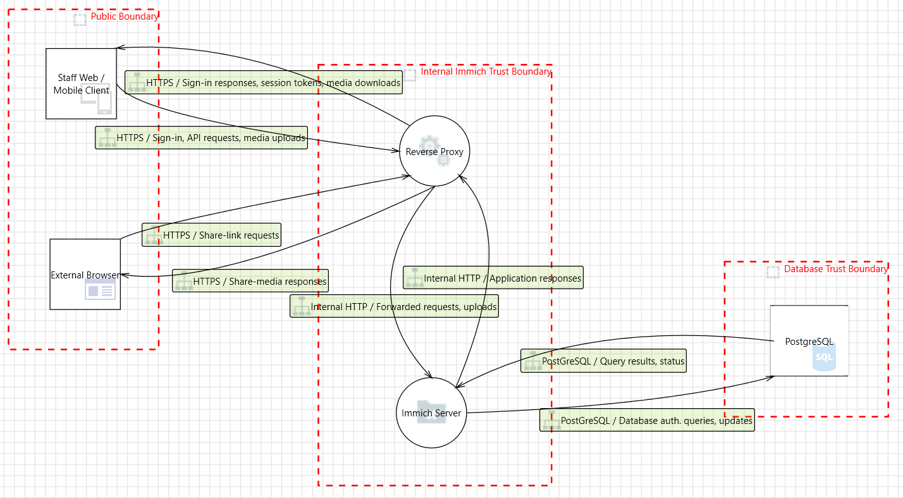

# Immich Threat Modeling Report

**Course:** Software Assurance  
**Project:** Immich Open-Source Photo Management System  
**Team:** Team 6

---

## 1. Introduction and Operational Context

### 1.1 Project Overview

Immich is an open-source, self-hosted photo and video management application that allows users to upload, organize, store, and share digital media. Since Immich handles potentially sensitive information, understanding its security risks is important for organizations considering its use.

For this assignment, Team 6 will examine Immich through data flow diagrams (DFDs) and threat modeling to identify potential security weaknesses, evaluate possible mitigations, and determine whether existing security controls adequately address the identified threats.

### 1.2 Operational Environment

Our team is continuing with the hypothetical professional photography studio introduced in our previous assignments. The studio employs five staff members who use Immich to manage client photographs and videos.

The assumed deployment includes web and mobile clients, an application server accessed through a reverse proxy, a PostgreSQL database, and file storage. Studio employees upload, organize, retrieve, and share client media, while an administrator manages the deployment. External clients may also access selected media through sharing links.

Because the studio manages private client information, unauthorized access, disclosure of photographs, modification of stored data, and service interruptions could negatively affect operations and client trust.

### 1.3 Threat Modeling Objectives

The purpose of this assignment is to identify potential security threats within Immich by examining how data moves between users, application components, and storage systems.

Our objectives are to:

- Develop Level 1 or Level 2 DFDs representing critical data flows.
- Identify trust boundaries and interactions that may introduce security risks.
- Use Microsoft's Threat Modeling Tool to identify potential STRIDE threats.
- Evaluate the relevance of generated threats and propose appropriate mitigations.
- Examine Immich's existing security controls and identify gaps requiring additional protection or verification.

The results will help us better understand how the security concerns identified in our previous assignments relate to Immich's architecture and data flows.

### 1.4 Scope and Assumptions

The threat modeling exercise focuses on the five security areas identified in our previous assurance case:

1. Authentication and Account Access
2. Photo/Video Access and Authorization
3. Network Communication Security
4. Stored Data Security
5. Availability and Data Preservation

The analysis considers our hypothetical studio deployment rather than every possible Immich configuration. We will examine relevant application components, user interactions, data flows, and trust boundaries.

Threats identified during this assignment represent potential security risks and do not necessarily indicate confirmed vulnerabilities in Immich. Additional investigation, configuration review, or testing may be required to determine whether specific threats are adequately mitigated.

---

## 2. Threat Modeling Methodology

### 2.1 Microsoft Threat Modeling Tool

Team 6 will use Microsoft's Threat Modeling Tool (TMT) to develop and analyze DFDs representing critical interactions within Immich.

The diagrams will identify external entities, processes, data stores, data flows, and trust boundaries. Each diagram will focus on the security scenarios established in our previous use/misuse case and assurance case assignments.

After creating the diagrams, we will use TMT to automatically generate potential threats. Each generated threat will be reviewed to determine whether it is relevant to the modeled system. For relevant threats, we will document proposed mitigation strategies and explain how they address the identified risks.

Full HTML reports generated by TMT will be included in the GitHub repository and linked from this report.

### 2.2 STRIDE Threat Categories

The threat analysis will use the STRIDE framework to examine six categories of security threats:

| Category | Description |
|---|---|
| Spoofing | An attacker impersonates a legitimate user, service, or system component. |
| Tampering | An attacker modifies information or system components without authorization. |
| Repudiation | A user or attacker denies performing an action because sufficient evidence is unavailable. |
| Information Disclosure | Sensitive information becomes accessible to unauthorized individuals or systems. |
| Denial of Service | An attacker disrupts the availability of a system or service. |
| Elevation of Privilege | An attacker gains permissions or access beyond what they are authorized to have. |

These categories provide a structured way to examine potential security weaknesses associated with the system's components and interactions.

### 2.3 Trust Boundaries

Trust boundaries separate components or environments with different levels of trust. Data crossing these boundaries may require additional security controls to prevent unauthorized access, modification, or disclosure.

For the assumed Immich deployment, potential trust boundaries include:

- External users and the studio's publicly accessible application entry point.
- The reverse proxy and internal application services.
- Application services and the PostgreSQL database.
- Application services and stored media files.
- Administrative operations and regular user operations.

The exact boundaries will be represented in the DFDs based on the components and interactions included in each scenario.

Particular attention will be given to interactions crossing trust boundaries because these may introduce opportunities for attackers to exploit differences in authentication, authorization, or network access.

### 2.4 Diagram Organization

Each team member is responsible for the security area assigned in our previous assurance case assignment.

Members may develop individual DFDs or collaborate on shared diagrams when their scenarios overlap. When diagrams are combined, the participating members will coordinate their contributions to ensure that all relevant data flows and security concerns are addressed.

The final report will include the applicable diagrams, relevant TMT-generated threats, proposed mitigations, and links to the exported HTML reports.

---

## 3. Data Flow Diagrams and Threat Analysis

Each team member is responsible for documenting their assigned security area.

For each diagram:
- Identify the relevant data flows and system components.
- Include the Level 1 or Level 2 DFD.
- Identify important trust boundaries.
- Review the threats automatically generated by TMT.
- Document relevant threats and proposed mitigations.
- Explain why any significant generated threats were considered not applicable.
- Provide a link to the full HTML report.

### 3.1 Authentication and Account Access

**Owner:** Christian Theisen

#### 3.1.1 Scenario Overview

[Describe the authentication, login, account access, and session-management scenarios.]

#### 3.1.2 DFD and Data Flows

[Insert the DFD image exported from TMT.]

[Explain the external entities, processes, data stores, data flows, and trust boundaries.]

#### 3.1.3 TMT-Generated Threats

| Threat ID | STRIDE Category | Affected Element / Flow | Threat Description | Relevance |
|---|---|---|---|---|
| TBD | TBD | TBD | TBD | TBD |

#### 3.1.4 Proposed Mitigations

| Threat ID | Proposed Mitigation | Rationale |
|---|---|---|
| TBD | TBD | TBD |

#### 3.1.5 HTML Threat Modeling Report

[View Authentication TMT Report](reports/authentication-report.html)

---

### 3.2 Photo/Video Access and Authorization

**Owner:** Adu

#### 3.2.1 Scenario Overview

[Describe private asset access, media authorization, shared links, and protected photo/video retrieval.]

#### 3.2.2 DFD and Data Flows

[Describe relevant components, flows, and trust boundaries.]

#### 3.2.3 TMT-Generated Threats

| Threat ID | STRIDE Category | Affected Element / Flow | Threat Description | Relevance |
|---|---|---|---|---|
| TBD | TBD | TBD | TBD | TBD |

#### 3.2.4 Proposed Mitigations

| Threat ID | Proposed Mitigation | Rationale |
|---|---|---|
| TBD | TBD | TBD |

#### 3.2.5 HTML Threat Modeling Report

[View Asset Authorization TMT Report](reports/asset-authorization-report.html)

---

### 3.3 Network Communication Security

**Owner:** Marc

#### 3.3.1 Scenario Overview

[Describe network communication between clients, the reverse proxy, application server, and internal services.]

#### 3.3.2 DFD and Data Flows

[Describe relevant components, flows, and trust boundaries.]

#### 3.3.3 TMT-Generated Threats

| Threat ID | STRIDE Category | Affected Element / Flow | Threat Description | Relevance |
|---|---|---|---|---|
| TBD | TBD | TBD | TBD | TBD |

#### 3.3.4 Proposed Mitigations

| Threat ID | Proposed Mitigation | Rationale |
|---|---|---|
| TBD | TBD | TBD |

#### 3.3.5 HTML Threat Modeling Report

[View Network Communication TMT Report](reports/network-communication-report.html)

---

### 3.4 Stored Data Security

**Owner:** Dillon

#### 3.4.1 Scenario Overview

This scenario focuses on how Immich stores and retrieves photos, videos, and their associated metadata. For a small photography studio, protecting stored data is important because employees need to access and manage client photos without exposing private information or allowing unauthorized changes.

Immich uses filesystem storage for photos and videos and PostgreSQL for application data and asset metadata. The main security concerns include unauthorized database access, excessive database permissions, sensitive information disclosure, SQL injection, and unauthorized modification of stored information.

The goal of this threat model is to identify potential risks involving the storage components and determine how those risks could be reduced.

#### 3.4.2 DFD and Data Flows

The data flow diagram was created using Microsoft Threat Modeling Tool and includes the following components:

- **Studio Employee:** The external user who uploads and retrieves photos and videos.
- **Immich Application Server:** Processes requests and communicates with the storage systems.
- **Media File Storage:** Stores the original photos and videos.
- **PostgreSQL Database:** Stores application data and asset metadata.
- **Self-Hosted Immich Server Boundary:** Represents the trust boundary around the server-side components.

The diagram includes six data flows:

1. Upload Photos and Videos
2. Retrieve Photos and Videos for Employee
3. Store Photos and Videos
4. Retrieve Photos and Videos
5. Store Asset Metadata
6. Retrieve Asset Metadata

The main trust boundary separates the studio employee from the self-hosted Immich server and its internal storage components.

#### 3.4.3 TMT-Generated Threats

Microsoft Threat Modeling Tool generated seven potential threats associated with the Store Asset Metadata interaction. These represent possible security risks rather than confirmed vulnerabilities in Immich.

| Threat ID | STRIDE Category | Affected Element / Flow | Threat Description | Relevance |
|---|---|---|---|---|
| T1 | Elevation of Privilege | Store Asset Metadata | Unauthorized database access through exposed network connections | Could allow attackers to access PostgreSQL |
| T2 | Elevation of Privilege | Store Asset Metadata | Database accounts have excessive permissions | Could allow unauthorized access to sensitive records |
| T3 | Information Disclosure | Store Asset Metadata | Sensitive database information could be exposed | Could expose photo metadata and application information |
| T4 | Information Disclosure | Store Asset Metadata | SQL injection could manipulate database queries | Could allow unauthorized reading or modification of data |
| T5 | Repudiation | Store Asset Metadata | Insufficient database auditing and logging | Could make unauthorized activity difficult to investigate |
| T6 | Tampering | Store Asset Metadata | Unauthorized modification of database records | Could compromise the integrity of stored metadata |
| T7 | Tampering | Store Asset Metadata | Insufficient monitoring of suspicious database activity | Could allow unauthorized activity to remain undetected |

*Threat IDs T1–T7 are labels used for this summary. Full threat descriptions and mitigation details are available in the exported Microsoft Threat Modeling Tool HTML report.*

#### 3.4.4 Proposed Mitigations

| Threat ID | Proposed Mitigation | Rationale |
|---|---|---|
| T1 | Restrict PostgreSQL network access to authorized application services and administrators | Reduces the risk of unauthorized database connections |
| T2 | Apply least-privilege database permissions and restrict administrative accounts | Limits the damage caused by compromised credentials |
| T3 | Protect database credentials, restrict access, and encrypt sensitive data and backups where appropriate | Reduces the risk of sensitive information disclosure |
| T4 | Use parameterized queries, validate input, and perform regular security testing | Helps prevent SQL injection attacks |
| T5 | Enable appropriate database auditing and protect security logs | Helps investigators identify unauthorized activity |
| T6 | Restrict database write permissions, validate changes, and maintain reliable backups | Helps prevent and recover from unauthorized modifications |
| T7 | Monitor unusual database activity and configure security alerts | Improves detection of suspicious database operations |

These mitigations are recommendations based on the identified threats. Some security protections are provided by Immich or PostgreSQL, while others require configuration by the organization operating the system.

#### 3.4.5 HTML Threat Modeling Report

[View Stored Data TMT Report](Immich_Stored_Data_Security_Report.htm)

The HTML report was exported from Microsoft Threat Modeling Tool and contains the data flow diagram and the seven generated threats.

---

### 3.5 Availability and Data Preservation

**Owner:** Matthew

#### 3.5.1 Scenario Overview

[Describe media availability, backups, recovery, system failures, and data preservation.]

#### 3.5.2 DFD and Data Flows

[Describe relevant components, flows, and trust boundaries.]

#### 3.5.3 TMT-Generated Threats

| Threat ID | STRIDE Category | Affected Element / Flow | Threat Description | Relevance |
|---|---|---|---|---|
| TBD | TBD | TBD | TBD | TBD |

#### 3.5.4 Proposed Mitigations

| Threat ID | Proposed Mitigation | Rationale |
|---|---|---|
| TBD | TBD | TBD |

#### 3.5.5 HTML Threat Modeling Report

[View Availability TMT Report](reports/availability-report.html)

---

## 4. Existing Security Controls and Gap Analysis

For each security area, review the Immich project for evidence of relevant security controls.

Distinguish between:
- Controls documented or implemented by Immich.
- Controls requiring deployment-specific configuration.
- Controls that could not be verified.
- Missing or insufficient mitigations.

### 4.1 Authentication and Account Access

**Owner:** Christian Theisen

#### Existing Security Controls

[Document relevant authentication and session-management controls found in Immich.]

#### Identified Security Gaps

[Identify missing, incomplete, or unverified mitigations.]

#### Recommended Improvements

[Describe additional security measures, testing, or configuration changes.]

---

### 4.2 Photo/Video Access and Authorization

**Owner:** Adu

#### Existing Security Controls

[Document relevant media authorization and sharing controls.]

#### Identified Security Gaps

[Identify missing, incomplete, or unverified mitigations.]

#### Recommended Improvements

[Describe recommended improvements.]

---

### 4.3 Network Communication Security

**Owner:** Marc

#### Existing Security Controls

[Document relevant HTTPS, proxy, certificate, and network controls.]

#### Identified Security Gaps

[Identify missing, incomplete, or unverified mitigations.]

#### Recommended Improvements

[Describe recommended improvements.]

---

### 4.4 Stored Data Security

**Owner:** Dillon

#### Existing Security Controls

Immich provides several security features that help protect stored photos, videos, and database information. Based on a review of Immich's official documentation and GitHub source code, the following controls were identified:

- **Database Access:** Immich uses PostgreSQL to store application data and photo metadata. Its recommended Docker Compose deployment does not publicly expose the database port, helping limit unauthorized network access.

- **Authentication:** Immich supports password-based authentication and OpenID Connect (OIDC), allowing administrators to control access to the application.

- **Database Query Security:** Immich uses the Kysely query builder for database operations, which supports structured query construction and can help reduce SQL injection risks when used correctly.

- **Data Backups:** Immich documents automatic database backups and restoration procedures. These help protect application data from accidental loss or corruption.

- **File Integrity:** Immich provides system integrity checks that can identify missing files, untracked files, and checksum mismatches.

- **Storage Permissions:** Immich relies on filesystem permissions and ownership settings to control access to stored media files.

These controls provide a foundation for protecting stored data, although some protections depend on how Immich is configured and deployed.

#### Identified Security Gaps

Using Microsoft Threat Modeling Tool, I identified seven potential threats related to storing asset metadata in PostgreSQL. These included unauthorized database access, excessive permissions, sensitive information disclosure, SQL injection, insufficient audit logging, unauthorized database modifications, and inadequate monitoring.

After reviewing Immich's documentation and source code, I identified several areas that may require additional security measures:

- **Database Exposure:** Although the recommended deployment does not publicly expose PostgreSQL, incorrect network configurations could still allow unauthorized connections.

- **Excessive Permissions:** PostgreSQL supports role-based permissions, but I could not verify that every Immich deployment follows the principle of least privilege.

- **Sensitive Data Protection:** I could not verify that all database files and backups are automatically encrypted at rest.

- **SQL Injection:** Immich uses a structured query builder, but this does not guarantee that every database interaction is protected against SQL injection.

- **Insufficient Logging:** I could not confirm that comprehensive database auditing is enabled by default to track unauthorized access or modifications.

- **Unauthorized Data Modification:** An attacker who gains database write access could potentially modify or delete important metadata.

- **Security Monitoring:** I could not verify that suspicious database activity automatically generates security alerts.

These are potential security gaps or areas requiring further verification, rather than confirmed vulnerabilities in Immich.

#### Recommended Improvements

Based on the threats identified and the existing security controls, I recommend the following improvements to strengthen stored data security:

- **Restrict Database Access:** Ensure PostgreSQL is accessible only to authorized application services and administrators. Use network isolation and firewall rules to prevent unnecessary exposure.

- **Apply Least Privilege:** Review database accounts and permissions to ensure users and services only have access to the information and operations they require.

- **Protect Sensitive Information:** Encrypt sensitive database files and backups where appropriate, and securely manage database credentials.

- **Prevent SQL Injection:** Continue using safe database query practices, including parameterized queries, input validation, and regular security testing.

- **Improve Audit Logging:** Configure PostgreSQL and application logging to record important security events, including unauthorized access attempts and unexpected changes.

- **Monitor Database Activity:** Implement monitoring and alerts for suspicious database connections, unusual queries, and unauthorized modifications.

- **Strengthen Backup Procedures:** Maintain separate backups of both the PostgreSQL database and the original photo and video files. Regularly test restoration procedures.

- **Protect Media Storage:** Review filesystem permissions and use Immich's integrity checks to help identify missing or modified files.

Overall, Immich provides several useful security controls, but protecting stored data also depends on how the organization configures and maintains its self-hosted environment. For a photography studio, the most important priorities are restricting database access, protecting original media files, maintaining reliable backups, and detecting suspicious activity.

---

### 4.5 Availability and Data Preservation

**Owner:** Matthew

#### Existing Security Controls

[Document relevant backup, recovery, integrity, and availability mechanisms.]

#### Identified Security Gaps

[Identify missing, incomplete, or unverified mitigations.]

#### Recommended Improvements

[Describe recommended improvements.]

---

## 5. Optional AI-Assisted Threat Analysis

**Note:** This section is optional and does not replace the required Microsoft Threat Modeling Tool analysis.

### 5.1 AI Analysis Method

[Document the AI tool, prompt, and DFD used, if applicable.]

### 5.2 AI-Identified STRIDE Threats

[Summarize threats identified through AI analysis.]

### 5.3 Comparison with TMT Results

[Compare threats and mitigations identified by AI against those generated by TMT.]

### 5.4 Reflection on AI Usefulness

[Discuss strengths, limitations, and differences between the approaches.]

---

## 6. Team Reflection

### 6.1 Individual Reflections

**Christian Theisen:**

[What did you learn? What was most useful?]

**Adu:**

[Individual reflection.]

**Marc:**

[Individual reflection.]

**Dillon:**

For this assignment, I focused on stored data security in Immich. I created a data flow diagram using Microsoft Threat Modeling Tool that showed how photos, videos, and metadata move between a studio employee, the Immich application server, media file storage, and PostgreSQL database. The tool identified seven potential threats related to database security. I reviewed these threats, proposed mitigations, and researched Immich's existing security controls using its official documentation and GitHub source code.

One challenge was learning how to use Microsoft Threat Modeling Tool, especially when creating the trust boundary and organizing the diagram. I also noticed that some generated recommendations were designed for Microsoft SQL Server rather than PostgreSQL, so they needed to be adapted to Immich. The most useful part of the assignment was learning how data flow diagrams help identify security risks. It also showed me that securing a self-hosted application requires both built-in security features and proper configuration by the organization using it.

**Matthew:**

[Individual reflection.]

### 6.2 Combined Team Reflection

[Summarize what the team learned from developing DFDs, analyzing STRIDE threats, identifying mitigations, and evaluating existing security controls.]

[Discuss the importance of trust boundaries and how threat modeling contributed to understanding Immich's security.]

[Describe any challenges encountered and lessons learned through collaboration.]

---

## 7. GitHub Collaboration

**Repository:** https://github.com/marc-fayad/team6-immich

**Project Board:** https://github.com/users/marc-fayad/projects/1

### 7.1 Task Assignments

The team will continue using the security areas assigned during our previous assurance case assignment.

| Team Member | Assigned Security Area |
|---|---|
| Christian Theisen | Authentication and Account Access |
| Adu | Photo/Video Access and Authorization |
| Marc | Network Communication Security |
| Dillon | Stored Data Security |
| Matthew | Availability and Data Preservation |

Each member is responsible for developing or contributing to the DFDs for their assigned area, reviewing relevant TMT-generated threats, identifying mitigation strategies, evaluating existing Immich security controls, and completing an individual reflection.

Members may collaborate on shared DFDs when their security scenarios overlap.

### 7.2 Collaboration Summary

Team 6 will use its existing GitHub repository and project board to organize and track work for this assignment.

GitHub issues will be used to document responsibilities and monitor progress. Team members will contribute their work through branches and pull requests, allowing changes to be reviewed before being merged into the main report.

Slack will be used to communicate progress, coordinate shared diagrams, and identify outstanding tasks.

[Update this section before submission to summarize the collaboration that actually occurred.]

---

## 8. References

1. Team 6. *Immich Software Assurance Case.* [Previous Team Report](ASSURANCE_CASE_REPORT.md).

2. Immich Contributors. *Immich — Open-Source Photo and Video Management.* [Official GitHub Repository](https://github.com/immich-app/immich).

3. Immich. *Official Documentation.* [Immich Documentation](https://docs.immich.app/).

4. Microsoft. *Threat Modeling Tool Overview.* [Microsoft Learn](https://learn.microsoft.com/en-us/azure/security/develop/threat-modeling-tool).

5. Microsoft. *Getting Started with the Threat Modeling Tool.* [Microsoft Learn](https://learn.microsoft.com/en-us/azure/security/develop/threat-modeling-tool-getting-started).

6. Microsoft. *Threat Modeling Tool Download.* [Download](https://aka.ms/threatmodelingtool)
   https://learn.microsoft.com/en-us/azure/security/develop/threat-modeling-tool-getting-started

6. Microsoft. *Threat Modeling Tool Download.*
   https://aka.ms/threatmodelingtool
